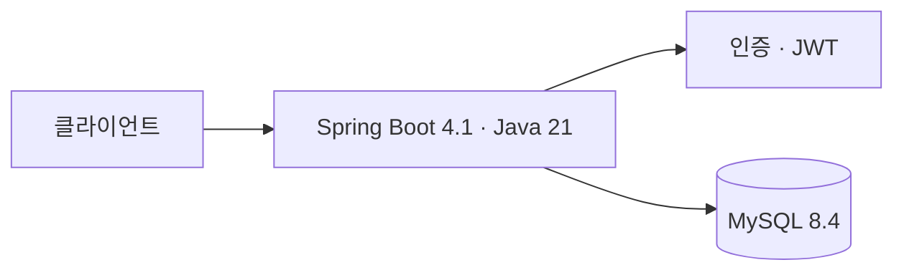

# 🚀 2026 GANZITHON · TEAM 07 Backend (서비스명: 테슬랑)

> “AI와 함께 감정을 정리하고, 나만의 감정 패턴을 발견하여 더 나은 방향으로 나아갈 수 있도록 돕는 개인화 감정 케어 서비스, **테슬랑**”

텍스트·음성으로 감정을 기록하고, 7단계 AI 질문과 대화(CBT, 소크라테스, SFBT, NVC 기반)로 생각을 정리하며, 축적된 기록에서 감정 패턴을 발견하도록 돕습니다. 대화 이후에는 감정에 맞는 말랑이(슬랑이, 스퀴시, 왁뿌볼)와 터치·드래그·ASMR 인터랙션으로 감각적인 감정 환기를 연결합니다. 또한 엄격한 위기 대응 규칙(Safety Guardrails)을 통해 안전한 멘탈케어 경험을 제공합니다.

현재는 Spring Boot 백엔드 초기 구성을 완료하고 확정된 MVP 기능(인증, AI 감정 상담, 마음 기록함, 말랑이 연계, 안전 대응) 구현을 준비하는 단계입니다. 자세한 배경과 사용자 흐름은 [서비스 기획안](docs/service-overview.md)을 확인하세요.

<br />

## 👥 팀원 소개 (Backend)

| 이름 | 소속 | 연락처 | 담당 역할 |
| :--- | :--- | :--- | :--- |
| 이영현 | 성결대학교 | [ejjm0727@gmail.com](mailto:ejjm0727@gmail.com) | 미정 |
| 양한울 | 수원대학교 | [gierdanigi123@gmail.com](mailto:gierdanigi123@gmail.com) | 미정 |
| 강현우 | 가천대학교 | [al457616@gachon.ac.kr](mailto:al457616@gachon.ac.kr) | 미정 |

<br />

## 🛠️ 기술 스택 (Tech Stack)

| 영역 | 기술 | 상태 |
| :--- | :--- | :--- |
| Backend Framework | Spring Boot 4.1.2 / Spring MVC | 초기 구성 완료 |
| Language / JDK | Java 21 | Gradle toolchain |
| Build | Gradle 9.8.2 | Wrapper 제공 |
| Data | MySQL 8.4 LTS / Spring Data JPA | 연결 설정 및 로컬 Compose 제공 |
| API Documentation | springdoc 3.2.0 / Swagger UI | 로컬 활성화 |
| LLM | | 미정 |
| Security | Spring Security / JWT | F-00 인증·인가 구현 |
| Infrastructure | 미정 | 배포 환경 선정 필요 |
| CI | GitHub Actions | PR 및 main push 시 훅·Java 21·MySQL 8.4 검사 |
| Deployment | 미정 | 배포 방식 선정 필요 |

<br />

## 🗺️ 시스템 아키텍처 (System Architecture)

기능별 헥사고날 구조를 사용합니다. F-00 인증 API와 health API를 제공하며 감정 탐색 업무 API·LLM 연동은 미구현입니다.



단일 Gradle 모듈에서 기능별 `domain / application / adapter` 구조를 사용하고 어댑터가 안쪽 application 포트에 의존하도록 구성합니다. 인증 도메인과 DB·OAuth·JWT 어댑터가 구현되어 있습니다.

구성 요소와 통신 방식은 [시스템 아키텍처](docs/architecture.md)에 정리합니다.

<br />

## 📊 ER Diagram (데이터베이스 구조)

7단계 AI 상담 세션(`emotion_records`), 대화 메시지(`counseling_messages`), 사용자 계정(`users`), 말랑이 이용 이력(`malangi_usages`)을 포함한 도메인 모델 초안이 수립되었습니다. 상세한 엔티티 명세와 관계도는 [데이터베이스 설계 및 ERD](docs/database.md)에서 확인할 수 있습니다.

<br />

## ✨ 핵심 기능 및 구현 상세 (Core Features)

- **사용자 인증 및 관리 (F-00, MVP 필수, 구현 완료):** 이메일·카카오·디스코드·구글 로그인, JWT 갱신·로그아웃, 내 프로필 조회
- **7단계 AI 감정 대화 (F-01~F-03, F-07, MVP 필수):** CBT·소크라테스·SFBT·NVC 기반 문답, 감정 강도 전/후 측정, 대안적 사고 및 작은 실천 도출
- **맞춤형 말랑이 추천 및 인터랙션 (F-04~F-06, F-10, MVP 필수):** 감정별 말랑이(슬랑이, 스퀴시, 왁뿌볼) 추천, 터치·드래그 조작 및 ASMR
- **마음 기록함 (F-08, MVP 필수):** 날짜별 상담 결과, 감정 변화, 실천 행동 저장 및 상세 조회
- **위기 신호 감지 및 안전 안내 (F-09, MVP 필수):** 자해·자살·타해 등 위기 감지 시 즉시 중단 및 긴급 상담 핫라인(109, 1577-0199 등) 연계
- **장기 통계 및 패턴 분석 (F-11~F-13, 후순위):** 누적 데이터 기반 월별 감정 통계, 자동적 사고 경향 및 개인화 인사이트

전체 기획 기능과 MVP 우선순위는 [기능 명세서](docs/features.md)에 정리되어 있습니다.

<br />

## 📑 API 명세서 (API Documentation)

요청·응답 형식, 인증 조건, 오류 응답은 [API 명세서](docs/api.md)에서 관리합니다. `GET /api/v1/health`와 F-00 인증 API를 제공합니다. 감정 탐색 업무 API는 아직 없으며, 로컬 실행 후 [Swagger UI](http://127.0.0.1:8080/swagger-ui/index.html)에서 API를 확인할 수 있습니다.

<br />

## 🔥 기술적 의사결정 및 트러블슈팅

채택한 기술과 추후 기술 선택·문제 해결 기록은 [기술적 의사결정 및 트러블슈팅](docs/technical-decisions.md)에 정리합니다.

<br />

## 🌲 Git 브랜치 전략 (Git Branching Strategy)

`origin`은 팀 저장소를 가리킵니다. 최신 `origin/main`에서 작업 브랜치를 만들고, 팀 저장소에 해당 브랜치를 push한 뒤 `main`으로 PR을 보냅니다. 로컬 `main`에는 팀에서 merge된 변경만 pull로 반영합니다.

- `main`: 팀 저장소의 기준 브랜치
- `feat/<이슈번호>-<기능명>`: 기능 개발
- `fix/<이슈번호>-<버그명>`: 버그 수정
- `docs/<설명>`: 문서 작성 및 수정
- `chore/<설명>`: 저장소 설정 및 유지보수

이슈 번호가 없으면 생략할 수 있습니다. 커밋은 `feat(auth): 로그인 API 추가`처럼 `<type>(<scope>): <한국어 설명>` 형식을 사용합니다.

```text
팀 origin/main → 작업 브랜치 → 팀 origin에 브랜치 push → main으로 PR → 리뷰·CI → merge
```

`main`에 직접 push하지 않으며, pre-push 훅을 우회하지 않습니다. 자세한 절차는 [협업 워크플로](docs/agents/workflow.md)와 [PR 작성 규칙](docs/agents/pr.md)을 확인하세요.

<br />

## ⚙️ 시작하기 (Getting Started)

```bash
git clone https://github.com/2026Ganzi-Thon/2026_GANZITHON_TEAM_07_BE.git
cd 2026_GANZITHON_TEAM_07_BE
```

JDK 21과 Docker Compose v2를 준비한 뒤 실행합니다.

```bash
cp .env.example .env
# .env의 로컬 DB 비밀번호를 변경하세요.
docker compose up -d --wait mysql
./gradlew bootRun
```

빌드·테스트: `./gradlew clean test bootJar`. 기본 테스트는 H2를 사용하며, 실제 MySQL 연결 검증 방법은 아래 실행 가이드를 참고합니다.

JDK 버전, 환경변수, 로컬 실행·테스트 절차는 [개발 환경 및 실행 가이드](docs/getting-started.md)에 정리합니다. 기여 시에는 팀 저장소 쓰기 권한을 준비하고 [협업 워크플로](docs/agents/workflow.md)의 원격 저장소 설정을 따릅니다.

<br />

## 📚 문서 모음

| 문서 | 내용 |
| :--- | :--- |
| [서비스 기획안](docs/service-overview.md) | 서비스 배경, 목표, 타겟, 사용자 흐름 |
| [기능 명세서](docs/features.md) | 기능별 요구사항, 처리 규칙, 완료 조건 |
| [AI 감정 대화 시스템](docs/emotional-dialogue/README.md) | 7단계 상담 프로세스, 위기 대응 6대 규칙, BE 대화 제어, 질문 전략 조사, 평가 프레임워크 |
| [API 명세서](docs/api.md) | 엔드포인트, 요청·응답, 인증, 오류 |
| [시스템 아키텍처](docs/architecture.md) | 시스템 구성과 통신 흐름 |
| [데이터베이스 설계 및 ERD](docs/database.md) | 테이블, 관계, 제약조건 |
| [기술적 의사결정 및 트러블슈팅](docs/technical-decisions.md) | 기술 선택 근거와 문제 해결 기록 |
| [개발 환경 및 실행 가이드](docs/getting-started.md) | 로컬 설정, 실행, 테스트 |
| [에이전트 개발 절차](docs/agents/development.md) | 문서 읽기, 범위 결정, 명세 구체화, 완료 기준 |
| [협업 워크플로](docs/agents/workflow.md) | 브랜치, 커밋, 팀 저장소 PR 절차 |
| [공유 저장소 전환](docs/shared-repository-migration.md) | 기존 fork 클론의 원격·main 추적 정리 |
