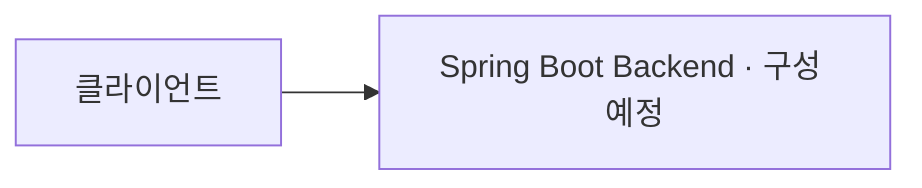

# 🚀 2026 GANZITHON · TEAM 07 Backend

> 2026 간지톤 7팀의 Spring Boot 기반 백엔드 프로젝트입니다.

현재 백엔드 구성을 준비하고 있습니다. 서비스 이름과 핵심 가치는 기획 확정 후 반영합니다.

<br />

## 👥 팀원 소개 (Backend)

| 이름 | 소속 | 연락처 | 담당 역할 |
| :--- | :--- | :--- | :--- |
| 이영현 | 성결대학교 | [ejjm0727@gmail.com](mailto:ejjm0727@gmail.com) | 미정 |
| 양한울 | 수원대학교 | [gierdanigi123@gmail.com](mailto:gierdanigi123@gmail.com) | 미정 |
| 강현우 | 가천대학교 | [al457616@gachon.ac.kr](mailto:al457616@gachon.ac.kr) | 미정 |

<br />

## 🛠️ 기술 스택 (Tech Stack)

| 영역 | 기술 | 상태 |
| :--- | :--- | :--- |
| Backend Framework | Spring Boot | 도입 예정, 버전 미정 |
| Language / JDK | 미정 | 프로젝트 초기 구성 시 결정 |
| Data | 미정 | DB 및 데이터 접근 기술 선정 필요 |
| Security | 미정 | 인증·인가 요구사항에 따라 결정 |
| Infrastructure | 미정 | 배포 환경 선정 필요 |
| CI/CD | 미정 | 빌드·배포 방식 선정 필요 |

<br />

## 🗺️ 시스템 아키텍처 (System Architecture)

아래는 구성 예정인 백엔드의 개념도입니다. 저장소에는 아직 실행 가능한 애플리케이션이 없습니다.



구성 요소와 통신 방식은 [시스템 아키텍처](docs/architecture.md)에 정리합니다.

<br />

## 📊 ER Diagram (데이터베이스 구조)

도메인과 데이터베이스는 설계 전입니다. 엔티티와 관계가 확정되면 [데이터베이스 설계 및 ERD](docs/database.md)에 Mermaid ERD를 작성합니다.

<br />

## ✨ 핵심 기능 및 구현 상세 (Core Features)

서비스 기획 확정 후 기능별 사용자 흐름, 처리 규칙, 구현 상태를 [기능 명세서](docs/features.md)에 정리합니다.

<br />

## 📑 API 명세서 (API Documentation)

요청·응답 형식, 인증 조건, 오류 응답은 [API 명세서](docs/api.md)에서 관리합니다. 현재 확정되거나 구현된 API는 없습니다.

<br />

## 🔥 기술적 의사결정 및 트러블슈팅

Spring Boot 도입 계획과 추후 기술 선택·문제 해결 기록은 [기술적 의사결정 및 트러블슈팅](docs/technical-decisions.md)에 정리합니다.

<br />

## 🌲 Git 브랜치 전략 (Git Branching Strategy)

`main`을 기준으로 작업 브랜치를 만들고, 개인 포크를 거쳐 팀 저장소로 PR을 보냅니다.

- `main`: 팀 저장소의 기준 브랜치
- `feat/<이슈번호>-<기능명>`: 기능 개발
- `fix/<이슈번호>-<버그명>`: 버그 수정
- `docs/<설명>`: 문서 작성 및 수정
- `chore/<설명>`: 저장소 설정 및 유지보수

이슈 번호가 없으면 생략할 수 있습니다. 커밋은 `feat(auth): 로그인 API 추가`처럼 `<type>(<scope>): <한국어 설명>` 형식을 사용합니다.

```text
팀 저장소 main → 작업 브랜치 → 개인 포크(origin)에 push → 팀 저장소(upstream)에 PR
```

`main`과 팀 저장소에 직접 push하지 않으며, pre-push 훅을 우회하지 않습니다. 자세한 절차는 [협업 워크플로](docs/agents/workflow.md)와 [PR 작성 규칙](docs/agents/pr.md)을 확인하세요.

<br />

## ⚙️ 시작하기 (Getting Started)

```bash
git clone https://github.com/2026Ganzi-Thon/2026_GANZITHON_TEAM_07_BE.git
cd 2026_GANZITHON_TEAM_07_BE
```

현재는 문서와 협업 설정만 포함되어 있습니다. Spring Boot 프로젝트 및 빌드 도구 구성 후 실행할 수 있습니다.

JDK 버전, 환경변수, 로컬 실행·테스트 절차는 [개발 환경 및 실행 가이드](docs/getting-started.md)에 정리합니다. 기여 시에는 먼저 개인 포크를 준비하고 [협업 워크플로](docs/agents/workflow.md)의 원격 저장소 설정을 따릅니다.

<br />

## 📚 문서 모음

| 문서 | 내용 |
| :--- | :--- |
| [기능 명세서](docs/features.md) | 기능별 요구사항, 처리 규칙, 완료 조건 |
| [API 명세서](docs/api.md) | 엔드포인트, 요청·응답, 인증, 오류 |
| [시스템 아키텍처](docs/architecture.md) | 시스템 구성과 통신 흐름 |
| [데이터베이스 설계 및 ERD](docs/database.md) | 테이블, 관계, 제약조건 |
| [기술적 의사결정 및 트러블슈팅](docs/technical-decisions.md) | 기술 선택 근거와 문제 해결 기록 |
| [개발 환경 및 실행 가이드](docs/getting-started.md) | 로컬 설정, 실행, 테스트 |
| [협업 워크플로](docs/agents/workflow.md) | 브랜치, 커밋, 포크 기반 PR 절차 |
