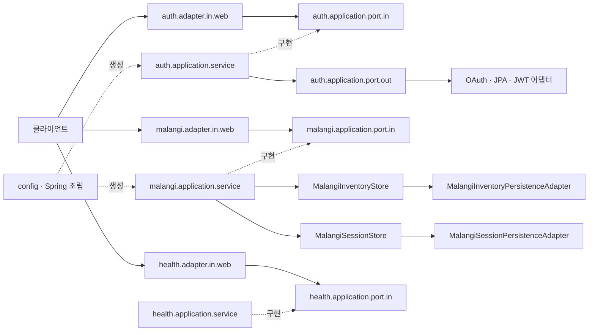

# 시스템 아키텍처

[README로 돌아가기](../README.md)

## 구성

단일 Gradle 모듈에서 기능별 헥사고날 구조를 사용합니다. [ADR-0002](adr/0002-feature-hexagonal-architecture.md)에 선택 이유를 기록합니다.



## 패키지와 책임

루트 패키지는 `com.ganzithon.backend`입니다.

```text
backend/
├── GanzithonApplication.java
├── config/                         # Spring bean 조립, OpenAPI 설정
├── common/adapter/in/web/          # 공통 API envelope
├── auth/                            # F-00 인증 유스케이스와 어댑터
│   ├── domain/
│   ├── application/port/{in,out}/
│   ├── application/service/
│   └── adapter/{in/web,out/{oauth,persistence,security}}/
├── malangi/                         # 인벤토리 조회·대표 종류 선택
│   ├── domain/
│   ├── application/port/{in,out}/
│   ├── application/service/
│   └── adapter/{in/web,out/persistence}/
└── health/
    ├── adapter/in/web/              # HTTP 요청·응답과 Swagger 명세
    └── application/
        ├── port/in/                 # CheckHealthUseCase, HealthStatus
        └── service/                 # 프레임워크에 의존하지 않는 구현
```

향후 업무 기능은 같은 기능 패키지 안에 필요한 `domain`, `application.port.out`,
`adapter.out`을 추가합니다. health에는 업무 도메인 규칙과 외부 호출이 없으므로
가상 도메인 객체, 출력 포트, DB·LLM 어댑터는 만들지 않습니다.

| 영역 | 책임과 의존 규칙 |
| --- | --- |
| `domain` | 업무 규칙. application·adapter·Spring·JPA·직접 JDBC에 의존하지 않음 |
| `application.port.in` | 입력 유스케이스와 그 결과 계약 |
| `application.service` | 입력 포트 구현. 필요한 도메인·출력 포트 사용, 외부 기술 의존 없음 |
| `application.port.out` | 외부 저장·조회·모델 호출이 필요할 때 내부에서 정의 |
| `adapter.in` | HTTP 등 외부 입력 변환. 서비스 구현체 대신 입력 포트에 의존 |
| `adapter.out` | 실제 DB·LLM 등 출력 포트 구현. 기능 구현 시 추가 |
| `config` | 바깥에서 Spring 의존성을 사용해 포트와 구현을 조립 |

`HexagonalArchitectureTests`가 application·domain의 외부 기술 의존, domain의
application 의존, 입력 어댑터의 서비스 구현체 직접 의존을 검사합니다. 실제 기능을 추가하기 전에는 빈 패키지를 허용합니다. 잘못된 외부 의존을 탐지하는 fixture 검사도 제공합니다.

## 현재 기능 및 외부 연동

- `GET /api/v1/health`: 인증 없이 서버의 HTTP 응답 확인, DB·LLM 조회 없음
- F-00: 이메일·비밀번호 인증, Kakao/Discord/Google Authorization Code 로그인, Refresh Token 회전·로그아웃, `/me` 프로필 조회 제공
- F-04/F-05 일부: 말랑이 인벤토리 조회·선택, 고유 상태 저장, 만지기 세션 시작·종료·이력 API 제공; 감정 기반 추천, 실제 터치 인터랙션, 상담 세션 연계는 미구현
- MySQL 8.4 / JPA / Flyway: 회원·Refresh Token·말랑이 보유 테이블을 V1으로 생성, V2에서 기존 회원의 기본 SLANGI 보정, V3에서 말랑이 상태 JSON과 만지기 세션 테이블 추가
- Spring Security / JWT Resource Server: 인증·OAuth 공개 경로 외에는 Access Token을 요구하며 Refresh Token은 API 인증에 사용할 수 없음
- Spring AI: Boot 4 호환 BOM과 공통 ChatClient API만 설치됨. provider/model 설정과 외부 호출은 미구현
- Actuator: 기본 health endpoint만 HTTP 노출
- Swagger UI와 OpenAPI: 기존 경로 유지, 기본 비활성화·로컬 활성화
- LLM provider/model 및 배포 환경: 미정

앱 API는 컨트롤러에서 `/api/v1` 경로를 사용합니다. servlet context path를
전역으로 설정하지 않아 Swagger UI와 `/v3/api-docs`는 이동하지 않습니다.
현재 JPA 자동 구성상 앱 기동에는 DB가 필요합니다. health의 UP은 DB·LLM까지
정상이라는 의미의 readiness가 아닙니다.

상세 응답은 [API 명세](api.md), 실행은 [실행 가이드](getting-started.md),
데이터 상태는 [DB 설계](database.md)를 참고합니다.

## AI 감정 대화 설계 검토

F-02의 질문 전략 선택과 BE 제어 책임은 [설계안](emotional-dialogue/design.md)에서 검토합니다. [감정 대화 문서](emotional-dialogue/README.md)에 질문 전략의 조사 근거와 평가 설계도 모읍니다. 기존 기능별 헥사고날 구조를 전제로 하되, 아직 업무 패키지·LLM 연동·저장 구조를 구현하거나 새 아키텍처 결정을 채택한 것은 아닙니다.
