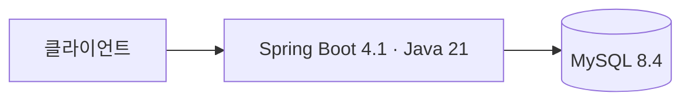

# 시스템 아키텍처

[README로 돌아가기](../README.md)

## 현재 구성

| 구성 요소 | 역할 | 상태 |
| :--- | :--- | :--- |
| Spring MVC 애플리케이션 | HTTP API 기반 | 초기 구성 완료, 업무 API 미구현 |
| Spring Data JPA / MySQL | 서비스 데이터 저장 기반 | 연결 설정 완료, 엔티티·스키마 미정 |
| springdoc / Swagger UI | OpenAPI 문서 생성 및 API 확인 | 로컬에서 활성화, 기본 비활성화 |
| LLM | 감정 탐색을 위한 후속 질문 생성 | 제공자·모델·연동 미정 |
| 배포 환경 / 인증 | 운영 실행 및 사용자 권한 | 미정 |

메인 클래스는 `com.ganzithon.backend.GanzithonApplication`, OpenAPI 설정은 `config.OpenApiConfig`입니다. 기능별 패키지와 데이터 모델은 실제 기능 구현 시 결정합니다. LLM SDK, 질문 생성 API, 대화 저장은 이번 기반 구성에 포함되지 않습니다.

실행 및 환경변수는 [개발 환경 가이드](getting-started.md), 데이터 모델 상태는 [데이터베이스 설계](database.md), 선택 근거는 [기술적 의사결정](technical-decisions.md)을 참고합니다.
