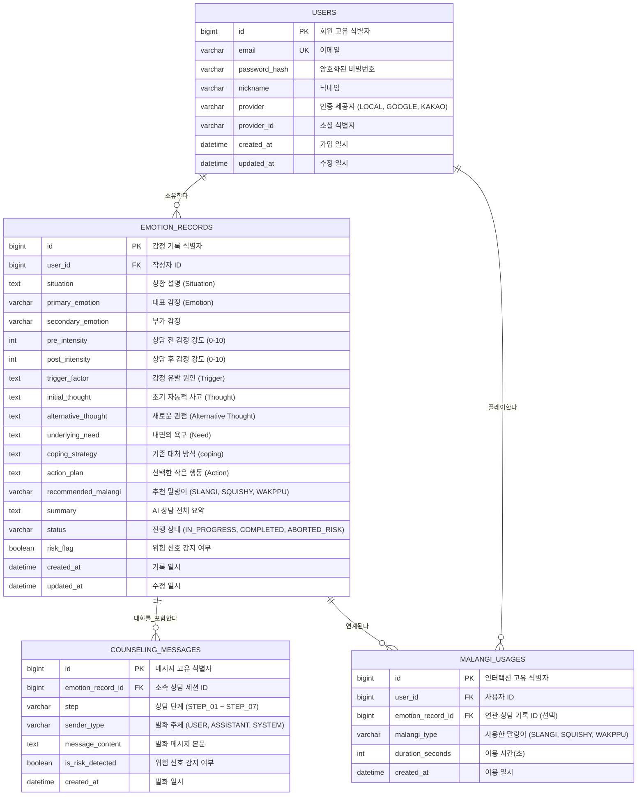

# 데이터베이스 설계 및 ERD

[README로 돌아가기](../README.md) · [서비스 기획안](service-overview.md) · [기능 명세서](features.md) · [API 명세서](api.md)

## 1. 개요 및 설계 원칙

테슬랑 서비스의 도메인 모델은 **7단계 AI 감정 상담 프로세스**와 **마음 기록함**, **사용자 인증**, **말랑이 인터랙션 이력**을 안정적으로 저장하고 관리할 수 있도록 설계되었습니다.

- **DBMS:** MySQL 8.4 LTS
- **ORM:** Spring Data JPA (`ddl-auto=validate`, 실 스키마는 마이그레이션 스크립트로 관리)
- **문자셋/콜레이션:** `utf8mb4` / `utf8mb4_unicode_ci`
- **보안 및 개인정보:**
  - 비밀번호 및 민감정보는 단방향 암호화(BCrypt) 처리
  - 위기 신호 감지 대화(`risk_flag = true`)는 개인화 통계/분석 쿼리에서 원천 배제
  - 사용자 탈퇴 또는 기록 삭제 시 연관된 대화 메시지 및 사용 이력을 안전하게 연쇄 삭제(Cascade) 또는 익명화

---

## 2. ER Diagram

---

## 3. 테이블 명세

### 3-1. `users` (회원 테이블)

- **목적:** 회원 계정 정보 및 인증 식별자 관리
- **관련 기능:** F-00 (사용자 인증 및 관리)

| 컬럼명 | 데이터 타입 | NULL 허용 | 키 / 제약조건 | 기본값 | 설명 |
| :--- | :--- | :--- | :--- | :--- | :--- |
| `id` | BIGINT | N | PK, AUTO_INCREMENT | — | 회원 고유 번호 |
| `email` | VARCHAR(255) | N | UNIQUE | — | 계정 이메일 |
| `password_hash` | VARCHAR(255) | Y | — | NULL | 암호화된 비밀번호 (소셜 로그인 시 NULL 가능) |
| `nickname` | VARCHAR(50) | N | — | — | 사용자 표시 닉네임 |
| `provider` | VARCHAR(20) | N | — | 'LOCAL' | 가입 경로 (`LOCAL`, `GOOGLE`, `KAKAO` 등) |
| `provider_id` | VARCHAR(255) | Y | — | NULL | 소셜 공급자 측 고유 ID |
| `created_at` | DATETIME(6) | N | — | CURRENT_TIMESTAMP(6) | 계정 생성 일시 |
| `updated_at` | DATETIME(6) | N | — | CURRENT_TIMESTAMP(6) | 계정 정보 수정 일시 |

---

### 3-2. `emotion_records` (상담 및 감정 기록 테이블)

- **목적:** 7단계 AI 상담 세션의 구조화된 데이터 및 마음 기록함의 영구 기록 보관
- **관련 기능:** F-01~F-04, F-07, F-08, F-09

| 컬럼명 | 데이터 타입 | NULL 허용 | 키 / 제약조건 | 기본값 | 설명 |
| :--- | :--- | :--- | :--- | :--- | :--- |
| `id` | BIGINT | N | PK, AUTO_INCREMENT | — | 감정 기록 고유 번호 |
| `user_id` | BIGINT | N | FK (`users.id`) | — | 작성 회원 식별자 |
| `situation` | TEXT | Y | — | NULL | 경험한 상황 및 사건 (Situation) |
| `primary_emotion` | VARCHAR(50) | Y | — | NULL | 대표 감정 (불안, 분노, 슬픔, 우울 등) |
| `secondary_emotion`| VARCHAR(50) | Y | — | NULL | 부가 감정 |
| `pre_intensity` | INT | Y | 0 ≤ 값 ≤ 10 | NULL | 대화 전 감정 강도 (사용자 직접 입력) |
| `post_intensity` | INT | Y | 0 ≤ 값 ≤ 10 | NULL | 대화 후 감정 강도 (상담 종료 시 입력) |
| `trigger_factor` | TEXT | Y | — | NULL | 감정을 유발한 촉발 사건 (Trigger) |
| `initial_thought` | TEXT | Y | — | NULL | 사건 당시 최초 자동적 사고 (Thought) |
| `alternative_thought`| TEXT | Y | — | NULL | 대화를 통해 발견한 새로운 관점 |
| `underlying_need` | TEXT | Y | — | NULL | 감정 이면에 자리잡은 핵심 욕구 (Need) |
| `coping_strategy` | TEXT | Y | — | NULL | 과거 대처 자원 및 버텨온 방법 (coping) |
| `action_plan` | TEXT | Y | — | NULL | 사용자가 선택한 현실적인 작은 실천 (Action) |
| `recommended_malangi`| VARCHAR(50)| Y | — | NULL | AI 추천 말랑이 (`SLANGI`, `SQUISHY`, `WAKPPU`) |
| `summary` | TEXT | Y | — | NULL | AI 상담 전체 요약 정리 |
| `status` | VARCHAR(20) | N | — | 'IN_PROGRESS' | 세션 상태 (`IN_PROGRESS`, `COMPLETED`, `ABORTED_RISK`) |
| `risk_flag` | BOOLEAN | N | — | FALSE | 위기/위험 신호 감지 플래그 |
| `created_at` | DATETIME(6) | N | — | CURRENT_TIMESTAMP(6) | 상담 시작 일시 |
| `updated_at` | DATETIME(6) | N | — | CURRENT_TIMESTAMP(6) | 최종 수정 일시 |

---

### 3-3. `counseling_messages` (상담 대화 메시지 테이블)

- **목적:** AI 상담 세션 중에 주고받은 턴(Turn)별 상세 발화 내역 저장
- **관련 기능:** F-02 (AI 대화), F-09 (위기 감지)

| 컬럼명 | 데이터 타입 | NULL 허용 | 키 / 제약조건 | 기본값 | 설명 |
| :--- | :--- | :--- | :--- | :--- | :--- |
| `id` | BIGINT | N | PK, AUTO_INCREMENT | — | 메시지 식별자 |
| `emotion_record_id`| BIGINT | N | FK (`emotion_records.id`) | — | 연관된 상담 세션 ID |
| `step` | VARCHAR(20) | N | — | 'STEP_01' | 진행 단계 (`STEP_01` ~ `STEP_07`) |
| `sender_type` | VARCHAR(20) | N | — | — | 발화 주체 (`USER`, `ASSISTANT`, `SYSTEM`) |
| `message_content` | TEXT | N | — | — | 메시지 내용 |
| `is_risk_detected`| BOOLEAN | N | — | FALSE | 해당 발화에서 위험 신호 감지 여부 |
| `created_at` | DATETIME(6) | N | — | CURRENT_TIMESTAMP(6) | 메시지 생성 일시 |

---

### 3-4. `malangi_usages` (말랑이 인터랙션 이력 테이블)

- **목적:** 사용자의 말랑이 터치/플레이 이력 및 이용 통계 저장
- **관련 기능:** F-04, F-05, F-06

| 컬럼명 | 데이터 타입 | NULL 허용 | 키 / 제약조건 | 기본값 | 설명 |
| :--- | :--- | :--- | :--- | :--- | :--- |
| `id` | BIGINT | N | PK, AUTO_INCREMENT | — | 인터랙션 이력 식별자 |
| `user_id` | BIGINT | N | FK (`users.id`) | — | 이용 회원 식별자 |
| `emotion_record_id`| BIGINT | Y | FK (`emotion_records.id`) | NULL | 상담 후 연계된 말랑이 이용인 경우 매핑 |
| `malangi_type` | VARCHAR(50) | N | — | — | 이용한 말랑이 (`SLANGI`, `SQUISHY`, `WAKPPU`) |
| `duration_seconds` | INT | N | — | 0 | 총 플레이 시간 (초 단위) |
| `created_at` | DATETIME(6) | N | — | CURRENT_TIMESTAMP(6) | 플레이 일시 |

---

## 4. 인덱스 및 성능 최적화

| 테이블명 | 인덱스 명칭 | 대상 컬럼 | 목적 및 선정 이유 |
| :--- | :--- | :--- | :--- |
| `users` | `uk_users_email` | `email` | 로그인 및 중복 가입 체크 유일성 보장 |
| `emotion_records` | `idx_records_user_created` | `user_id`, `created_at DESC` | 마음 기록함 최신순 페이징 목록 조회 가속 |
| `emotion_records` | `idx_records_user_risk` | `user_id`, `risk_flag` | 통계/분석 쿼리 시 위험 기록(`risk_flag = true`) 고속 필터링 |
| `counseling_messages` | `idx_messages_session_id` | `emotion_record_id`, `created_at ASC` | 대화 세션의 메시지 순차 로딩 가속 |
| `malangi_usages` | `idx_malangi_user_created` | `user_id`, `created_at DESC` | 사용자별 말랑이 이용 패턴 조회 |

---

## 5. 데이터 보관, 위험 관리 및 삭제 정책

1. **위험 신호 기록 격리 (`risk_flag`):**
   - 위험 신호가 감지되어 중단된 세션은 `risk_flag = true` 및 `status = 'ABORTED_RISK'`로 저장됩니다.
   - 향후 고도화될 감정 통계(F-11)나 패턴 분석(F-12) 쿼리 작성 시 `WHERE risk_flag = FALSE` 조건을 필수로 적용하여 안전성을 확보합니다.
2. **삭제 정책 (Data Deletion):**
   - 사용자가 마음 기록함에서 특정 감정 기록을 삭제할 경우, 해당 `emotion_records` 레코드와 연관된 `counseling_messages`는 외래키 `ON DELETE CASCADE` 또는 서비스 계층 트랜잭션 처리를 통해 완전 삭제됩니다.
   - 회원 탈퇴 시 사용자의 모든 개인 데이터는 복구 불가능하게 영구 삭제됩니다.
