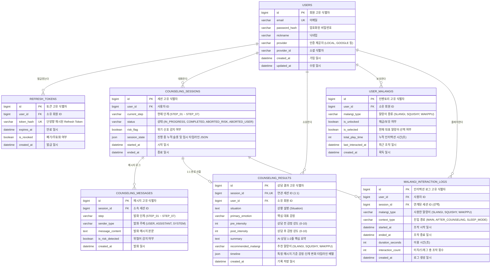

# 데이터베이스 설계 및 ERD

[README로 돌아가기](../README.md) · [서비스 기획안](service-overview.md) · [기능 명세서](features.md) · [API 명세서](api.md) · [AI 감정 대화 시스템](emotional-dialogue/README.md)

## 1. 개요 및 설계 원칙

테슬랑 서비스의 도메인 모델은 **AI 대화 세션의 실시간 턴 및 진행 상태 관리**, **시계열 감정·단계 변화 타임라인(Timeline Array)**, **마음 기록함**, **JWT 토큰 생명주기 관리**, **말랑이 인벤토리 및 인터랙션 시계열 로깅**을 안정적으로 저장하고 관리할 수 있도록 설계되었습니다.

- **DBMS:** MySQL 8.4 LTS
- **ORM:** Spring Data JPA (`ddl-auto=validate`, 실 스키마는 마이그레이션 스크립트로 관리)
- **문자셋/콜레이션:** `utf8mb4` / `utf8mb4_unicode_ci`
- **핵심 아키텍처 원칙:**
  - **세션(진행 중 상태)과 결과(최종 산출물)의 분리:**
    - 대화 진행 중에는 `counseling_sessions.session_state` JSON 컬럼에 각 단계별 추출 슬롯과 타임라인 이벤트를 점진적으로 누적합니다.
    - 상담 완료 시점에만 검증된 최종 산출물로서 `counseling_results` 레코드를 1회 생성합니다.
  - **시계열 타임라인(Timeline Array) 채택:** 특정 메시지 시점부터 일어난 감정 강도 변화, 단계 전환, 인지적 통찰을 `timeline` JSON 배열로 보관합니다.
  - **토큰 무효화 및 회전(Rotate) 관리:** `refresh_tokens` 테이블을 통해 안전한 토큰 재발급과 로그아웃 시 즉각적인 폐기를 보장합니다.
  - **말랑이 추천 시 자동 해금(Unlock) 및 시계열 로깅:**
    - 잠긴 말랑이가 추천되면 `user_malangis.is_unlocked = TRUE`로 즉시 해금합니다.
    - `malangi_interaction_logs`에 정확한 시작/종료 일시를 기록합니다.
  - **위기 신호 격리 및 삭제 일원화:**
    - 위기 감지 세션(`risk_flag = true`, `status = 'ABORTED_RISK'`)은 `counseling_results`를 생성하지 않아 통계에서 원천 배제됩니다.
    - 삭제는 `sessionId` 기준으로 연관된 메시지, 임시 상태, 완료 결과를 일괄 완전 삭제(Cascade)합니다.

---

## 2. ER Diagram



---

## 3. 테이블 상세 명세

### 3-1. `users` (회원 테이블)

- **목적:** 로컬 및 소셜(카카오, 디스코드, 구글) 계정 정보 및 인증 식별자 관리
- **관련 기능:** F-00 (사용자 인증 및 관리)

| 컬럼명 | 데이터 타입 | NULL 허용 | 키 / 제약조건 | 기본값 | 설명 |
| :--- | :--- | :--- | :--- | :--- | :--- |
| `id` | BIGINT | N | PK, AUTO_INCREMENT | — | 회원 고유 번호 |
| `email` | VARCHAR(255) | N | UNIQUE | — | 계정 이메일 (플랫폼 간 중복 가입 방지) |
| `password_hash` | VARCHAR(255) | Y | — | NULL | 암호화된 비밀번호 (소셜 로그인 시 NULL) |
| `nickname` | VARCHAR(50) | N | — | — | 사용자 표시 닉네임 (소셜 프로필 기본값 활용) |
| `provider` | VARCHAR(20) | N | — | 'LOCAL' | 가입 경로 (`LOCAL`, `KAKAO`, `DISCORD`, `GOOGLE`) |
| `provider_id` | VARCHAR(255) | Y | — | NULL | 소셜 공급자 측 고유 ID (로컬 가입 시 NULL) |
| `created_at` | DATETIME(6) | N | — | CURRENT_TIMESTAMP(6) | 가입 일시 |
| `updated_at` | DATETIME(6) | N | — | CURRENT_TIMESTAMP(6) | 수정 일시 |

- **복합 유니크 제약:** `UNIQUE(provider, provider_id)` (소셜 공급자별 계정 유일성 보장)
- **동일 이메일 정책:** 이미 동일한 이메일로 가입된 계정(예: LOCAL 또는 다른 Provider)이 존재할 경우 신규 가입을 거부하고 기존 등록된 공급자로 로그인을 안내합니다.

---

### 3-2. `refresh_tokens` (JWT 갱신 토큰 테이블 ★신규)

- **목적:** 토큰 회전(Rotation) 및 로그아웃 시 즉시 폐기(Revoke) 관리
- **관련 기능:** F-00 (사용자 인증 및 세션 관리)

| 컬럼명 | 데이터 타입 | NULL 허용 | 키 / 제약조건 | 기본값 | 설명 |
| :--- | :--- | :--- | :--- | :--- | :--- |
| `id` | BIGINT | N | PK, AUTO_INCREMENT | — | 토큰 식별자 |
| `user_id` | BIGINT | N | FK (`users.id`) | — | 소유 회원 ID |
| `token_hash` | VARCHAR(255) | N | UNIQUE | — | SHA-256 해시된 Refresh Token 값 |
| `expires_at` | DATETIME(6) | N | — | — | 토큰 만료 일시 (발급 후 14일) |
| `is_revoked` | BOOLEAN | N | — | FALSE | 로그아웃 또는 회전으로 폐기되었는지 여부 |
| `created_at` | DATETIME(6) | N | — | CURRENT_TIMESTAMP(6) | 발급 일시 |

---

### 3-3. `counseling_sessions` (AI 대화 세션 테이블)

- **목적:** 실시간 대화 상태 머신, 진행 중 슬롯 및 임시 타임라인 저장
- **관련 기능:** F-01, F-02, F-09

| 컬럼명 | 데이터 타입 | NULL 허용 | 키 / 제약조건 | 기본값 | 설명 |
| :--- | :--- | :--- | :--- | :--- | :--- |
| `id` | BIGINT | N | PK, AUTO_INCREMENT | — | 세션 고유 ID |
| `user_id` | BIGINT | N | FK (`users.id`) | — | 참여 회원 ID |
| `current_step` | VARCHAR(20) | N | — | 'STEP_01' | 현재 진행 단계 (`STEP_01` ~ `STEP_07`) |
| `status` | VARCHAR(20) | N | — | 'IN_PROGRESS' | 세션 상태 (`IN_PROGRESS`, `COMPLETED`, `ABORTED_RISK`, `ABORTED_USER`) |
| `risk_flag` | BOOLEAN | N | — | FALSE | 위기 신호 감지 여부 |
| `session_state`| JSON | N | — | — | **진행 중 누적 슬롯 및 임시 타임라인 스냅샷 (상세 구조 아래 참조)** |
| `started_at` | DATETIME(6) | N | — | CURRENT_TIMESTAMP(6) | 세션 시작 일시 |
| `ended_at` | DATETIME(6) | Y | — | NULL | 세션 종료 일시 |

#### `session_state` JSON 구조 예시
대화가 진행되는 동안 추출된 중간 슬롯과 타임라인 이벤트를 실시간으로 담아둡니다:
```json
{
  "slots": {
    "situation": "팀 회의에서 내 의견이 무시당한 것 같아 마음이 답답함",
    "primaryEmotion": "속상함",
    "preIntensity": 8,
    "triggerFactor": "팀 프로젝트 회의 안건 패스",
    "initialThought": "팀원들이 나를 무능하다고 생각하는구나",
    "alternativeThought": "마감 시간이 촉박해서 안건을 서둘렀을 수 있다",
    "underlyingNeed": "의견 존중 및 팀 기여 욕구",
    "copingStrategy": "산책 또는 혼자 차분히 생각 정리",
    "actionPlan": "다음 회의 전 메모로 먼저 공유하기"
  },
  "inProgressTimeline": [
    {
      "order": 1,
      "triggerMessageId": 3,
      "step": "STEP_02",
      "emotion": "속상함",
      "intensity": 8,
      "thought": "팀원들이 나를 무능하다고 생각하는구나",
      "timestamp": "2026-11-07T20:31:10"
    }
  ]
}
```

---

### 3-4. `counseling_messages` (대화 메시지 로그 테이블)

| 컬럼명 | 데이터 타입 | NULL 허용 | 키 / 제약조건 | 기본값 | 설명 |
| :--- | :--- | :--- | :--- | :--- | :--- |
| `id` | BIGINT | N | PK, AUTO_INCREMENT | — | 메시지 고유 ID |
| `session_id` | BIGINT | N | FK (`counseling_sessions.id`) | — | 소속 세션 ID |
| `step` | VARCHAR(20) | N | — | 'STEP_01' | 발화 당시 진행 단계 |
| `sender_type` | VARCHAR(20) | N | — | — | 발화 주체 (`USER`, `ASSISTANT`, `SYSTEM`) |
| `message_content`| TEXT | N | — | — | 메시지 본문 |
| `is_risk_detected`| BOOLEAN | N | — | FALSE | 해당 발화의 위험어 감지 여부 |
| `created_at` | DATETIME(6) | N | — | CURRENT_TIMESTAMP(6) | 발화 일시 |

---

### 3-5. `counseling_results` (마음 기록함 / 최종 상담 결과 테이블)

| 컬럼명 | 데이터 타입 | NULL 허용 | 키 / 제약조건 | 기본값 | 설명 |
| :--- | :--- | :--- | :--- | :--- | :--- |
| `id` | BIGINT | N | PK, AUTO_INCREMENT | — | 상담 결과 고유 ID |
| `session_id` | BIGINT | N | FK (`counseling_sessions.id`), UNIQUE | — | 연계 세션 ID (1:1) |
| `user_id` | BIGINT | N | FK (`users.id`) | — | 작성 회원 ID |
| `situation` | TEXT | Y | — | NULL | 핵심 사건/상황 (Situation) |
| `primary_emotion`| VARCHAR(50)| Y | — | NULL | 핵심 대표 감정 |
| `pre_intensity` | INT | Y | 0 ≤ 값 ≤ 10 | NULL | 대화 시작 전 감정 강도 |
| `post_intensity`| INT | Y | 0 ≤ 값 ≤ 10 | NULL | 대화 종료 후 감정 강도 |
| `summary` | TEXT | Y | — | NULL | AI 상담 1~2줄 핵심 요약 |
| `recommended_malangi`| VARCHAR(50)| Y | — | NULL | 추천 말랑이 (`SLANGI`, `SQUISHY`, `WAKPPU`) |
| `timeline` | JSON | N | — | — | 특정 메시지 기준 감정·단계 변화 타임라인 배열 (세션 완료 시 확정 복사) |
| `created_at` | DATETIME(6) | N | — | CURRENT_TIMESTAMP(6) | 기록 일시 |

---

### 3-6. `user_malangis` (말랑이 인벤토리 테이블)

| 컬럼명 | 데이터 타입 | NULL 허용 | 키 / 제약조건 | 기본값 | 설명 |
| :--- | :--- | :--- | :--- | :--- | :--- |
| `id` | BIGINT | N | PK, AUTO_INCREMENT | — | 인벤토리 항목 ID |
| `user_id` | BIGINT | N | FK (`users.id`) | — | 소유 회원 ID |
| `malangi_type` | VARCHAR(50) | N | — | — | 말랑이 종류 (`SLANGI`, `SQUISHY`, `WAKPPU`) |
| `is_unlocked` | BOOLEAN | N | — | FALSE | **해금 여부 (상담 완료 시 추천되면 자동 TRUE로 전환)** |
| `is_selected` | BOOLEAN | N | — | FALSE | 메인 화면 대표 말랑이 선택 여부 |
| `total_play_time`| INT | N | — | 0 | 누적 만진 시간 (초) |
| `last_interacted_at`| DATETIME(6)| Y | — | NULL | 가장 최근에 만진 일시 |
| `created_at` | DATETIME(6) | N | — | CURRENT_TIMESTAMP(6) | 획득/생성 일시 |

---

### 3-7. `malangi_interaction_logs` (말랑이 인터랙션 로그 테이블)

| 컬럼명 | 데이터 타입 | NULL 허용 | 키 / 제약조건 | 기본값 | 설명 |
| :--- | :--- | :--- | :--- | :--- | :--- |
| `id` | BIGINT | N | PK, AUTO_INCREMENT | — | 인터랙션 로그 ID |
| `user_id` | BIGINT | N | FK (`users.id`) | — | 회원 ID |
| `session_id` | BIGINT | Y | FK (`counseling_sessions.id`) | NULL | 연계된 상담 세션 ID |
| `malangi_type` | VARCHAR(50) | N | — | — | 만진 말랑이 (`SLANGI`, `SQUISHY`, `WAKPPU`) |
| `context_type` | VARCHAR(30) | N | — | 'MAIN' | 진입 맥락 (`MAIN`, `AFTER_COUNSELING`, `SLEEP_MODE`) |
| `started_at` | DATETIME(6) | N | — | CURRENT_TIMESTAMP(6) | 만지기 시작한 일시 |
| `ended_at` | DATETIME(6) | N | — | CURRENT_TIMESTAMP(6) | 만지기를 마친 일시 |
| `duration_seconds`| INT | N | — | 0 | 만진 시간 (초) |
| `interaction_count`| INT | N | — | 0 | 총 조작 횟수 |
| `created_at` | DATETIME(6) | N | — | CURRENT_TIMESTAMP(6) | 로그 저장 일시 |

---

## 4. 인덱스 설계 및 최적화

| 테이블명 | 인덱스 명칭 | 대상 컬럼 | 목적 및 선정 이유 |
| :--- | :--- | :--- | :--- |
| `users` | `uk_users_email` | `email` | 이메일 유일성 보장 및 로그인 조회 가속 |
| `users` | `uk_users_provider_id` | `provider`, `provider_id` | 소셜 공급자별 계정 식별 유일성 보장 |
| `refresh_tokens` | `uk_token_hash` | `token_hash` | 토큰 조회 및 재발급 시 해시값 일치 검증 |
| `refresh_tokens` | `idx_tokens_user` | `user_id`, `is_revoked` | 로그아웃 시 해당 회원의 모든 유효 토큰 일괄 폐기 |
| `counseling_sessions` | `idx_sessions_user_status` | `user_id`, `status` | 사용자의 진행 중 세션 여부 고속 확인 |
| `counseling_messages` | `idx_messages_session_id` | `session_id`, `created_at ASC` | 세션 발화 이력 순차 로딩 가속 |
| `counseling_results` | `uk_results_session_id` | `session_id` | 세션당 단 1건의 결과 보장 (1:1) |
| `counseling_results` | `idx_results_user_created` | `user_id`, `created_at DESC` | 마음 기록함 최신순 페이징 목록 조회 가속 |
| `user_malangis` | `uk_user_malangi` | `user_id`, `malangi_type` | 사용자별 말랑이 보유 유일성 보장 |
| `malangi_interaction_logs` | `idx_logs_user_started` | `user_id`, `started_at DESC` | 사용자별 최근 조작 이력 시계열 조회 |

---

## 5. 데이터 보관, 격리 및 삭제 일원화 정책

1. **위험 신호 격리:**
   - 위기 감지 세션은 `counseling_sessions`에 `risk_flag = true`, `status = 'ABORTED_RISK'`로만 남고, `counseling_results`는 생성되지 않습니다.
   - 통계 및 개인화 분석은 `counseling_results`만을 대상으로 하므로 위험 기록이 원천 배제됩니다.
2. **세션 기반 일원화 삭제 정책:**
   - 모든 상담 관련 데이터의 삭제 기준은 **`counseling_sessions.id` (세션 ID)**입니다.
   - 세션 삭제 API(`DELETE /api/v1/counseling/sessions/{sessionId}`) 호출 시, 외래키 `ON DELETE CASCADE` 또는 서비스 트랜잭션에 의해 연관된 `counseling_messages`, `counseling_results`가 세션 상태(`IN_PROGRESS`, `ABORTED_RISK`, `COMPLETED`)와 무관하게 일괄 영구 삭제됩니다.
3. **잠긴 말랑이 추천 시 자동 해금 규칙:**
   - 상담 완료 트랜잭션에서 `recommended_malangi`에 해당하는 말랑이가 잠겨있을 경우(`is_unlocked = FALSE`), 동일 트랜잭션 내에서 `is_unlocked = TRUE`로 갱신하여 사용자가 추천 즉시 플레이할 수 있도록 보장합니다.
