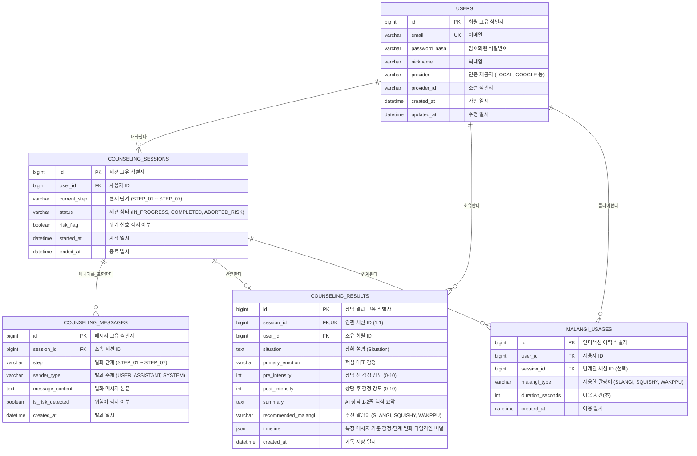

# 데이터베이스 설계 및 ERD

[README로 돌아가기](../README.md) · [서비스 기획안](service-overview.md) · [기능 명세서](features.md) · [API 명세서](api.md) · [AI 감정 대화 시스템](emotional-dialogue/README.md)

## 1. 개요 및 설계 원칙

테슬랑 서비스의 도메인 모델은 **AI 대화 세션의 실시간 턴 관리**, **시계열 감정·단계 변화 타임라인(Timeline Array)**, **마음 기록함**, **사용자 인증**, **말랑이 인터랙션 이력**을 안정적으로 저장하고 관리할 수 있도록 설계되었습니다.

- **DBMS:** MySQL 8.4 LTS
- **ORM:** Spring Data JPA (`ddl-auto=validate`, 실 스키마는 마이그레이션 스크립트로 관리)
- **문자셋/콜레이션:** `utf8mb4` / `utf8mb4_unicode_ci`
- **핵심 아키텍처 원칙:**
  - **세션(Session)과 결과(Result)의 분리:** 실시간 대화 흐름을 관리하는 `counseling_sessions`와 상담 완료 시 생성되는 최종 구조화 산출물인 `counseling_results`를 1:1로 분리하여 NULL 컬럼을 제거하고 조회 성능을 최적화합니다.
  - **시계열 타임라인(Timeline Array) 채택 (MySQL JSON 타입):** 특정 메시지 시점부터 일어난 감정 강도 변화, 단계 전환, 인지적 통찰(Aha-moment)을 `counseling_results.timeline` JSON 배열 컬럼으로 저장하여 프론트엔드 타임라인 시각화에 최적화합니다.
  - **위기 신호 안전 격리:** 위기 감지 세션(`risk_flag = true`, `status = 'ABORTED_RISK'`)은 개인화 통계나 AI 패턴 분석 쿼리에서 원천 배제합니다.

---

## 2. ER Diagram



---

## 3. 테이블 상세 명세

### 3-1. `users` (회원 테이블)

- **목적:** 회원 계정 정보 및 인증 식별자 관리
- **관련 기능:** F-00 (사용자 인증 및 관리)

| 컬럼명 | 데이터 타입 | NULL 허용 | 키 / 제약조건 | 기본값 | 설명 |
| :--- | :--- | :--- | :--- | :--- | :--- |
| `id` | BIGINT | N | PK, AUTO_INCREMENT | — | 회원 고유 번호 |
| `email` | VARCHAR(255) | N | UNIQUE | — | 계정 이메일 |
| `password_hash` | VARCHAR(255) | Y | — | NULL | 암호화된 비밀번호 (소셜 로그인 시 NULL) |
| `nickname` | VARCHAR(50) | N | — | — | 사용자 표시 닉네임 |
| `provider` | VARCHAR(20) | N | — | 'LOCAL' | 가입 경로 (`LOCAL`, `GOOGLE`, `KAKAO` 등) |
| `provider_id` | VARCHAR(255) | Y | — | NULL | 소셜 공급자 측 고유 ID |
| `created_at` | DATETIME(6) | N | — | CURRENT_TIMESTAMP(6) | 가입 일시 |
| `updated_at` | DATETIME(6) | N | — | CURRENT_TIMESTAMP(6) | 수정 일시 |

---

### 3-2. `counseling_sessions` (AI 대화 세션 테이블)

- **목적:** AI 감정 상담 세션(대화방)의 실시간 진행 상태와 생명주기 관리
- **관련 기능:** F-01, F-02, F-09

| 컬럼명 | 데이터 타입 | NULL 허용 | 키 / 제약조건 | 기본값 | 설명 |
| :--- | :--- | :--- | :--- | :--- | :--- |
| `id` | BIGINT | N | PK, AUTO_INCREMENT | — | 세션 고유 ID |
| `user_id` | BIGINT | N | FK (`users.id`) | — | 참여 회원 ID |
| `current_step` | VARCHAR(20) | N | — | 'STEP_01' | 현재 진행 단계 (`STEP_01` ~ `STEP_07`) |
| `status` | VARCHAR(20) | N | — | 'IN_PROGRESS' | 세션 상태 (`IN_PROGRESS`, `COMPLETED`, `ABORTED_RISK`) |
| `risk_flag` | BOOLEAN | N | — | FALSE | 위기 신호 감지 여부 |
| `started_at` | DATETIME(6) | N | — | CURRENT_TIMESTAMP(6) | 세션 시작 일시 |
| `ended_at` | DATETIME(6) | Y | — | NULL | 세션 종료 일시 |

---

### 3-3. `counseling_messages` (대화 메시지 로그 테이블)

- **목적:** 세션 내부에서 주고받은 턴(Turn)별 실시간 발화 메시지 아카이빙
- **관련 기능:** F-02, F-09

| 컬럼명 | 데이터 타입 | NULL 허용 | 키 / 제약조건 | 기본값 | 설명 |
| :--- | :--- | :--- | :--- | :--- | :--- |
| `id` | BIGINT | N | PK, AUTO_INCREMENT | — | 메시지 고유 ID |
| `session_id` | BIGINT | N | FK (`counseling_sessions.id`) | — | 소속 세션 ID |
| `step` | VARCHAR(20) | N | — | 'STEP_01' | 발화 당시 진행 단계 |
| `sender_type` | VARCHAR(20) | N | — | — | 발화 주체 (`USER`, `ASSISTANT`, `SYSTEM`) |
| `message_content`| TEXT | N | — | — | 메시지 본문 |
| `is_risk_detected`| BOOLEAN | N | — | FALSE | 해당 발화의 위험어 감지 여부 |
| `created_at` | DATETIME(6) | N | — | CURRENT_TIMESTAMP(6) | 발화 일시 |

---

### 3-4. `counseling_results` (마음 기록함 / 상담 결과 테이블)

- **목적:** 상담이 완료(`COMPLETED`)되었을 때 생성되는 최종 산출물 및 시계열 변화 기록
- **관련 기능:** F-03, F-04, F-07, F-08

| 컬럼명 | 데이터 타입 | NULL 허용 | 키 / 제약조건 | 기본값 | 설명 |
| :--- | :--- | :--- | :--- | :--- | :--- |
| `id` | BIGINT | N | PK, AUTO_INCREMENT | — | 상담 결과 고유 ID |
| `session_id` | BIGINT | N | FK (`counseling_sessions.id`), UNIQUE | — | 연계 세션 ID (1:1) |
| `user_id` | BIGINT | N | FK (`users.id`) | — | 작성 회원 ID |
| `situation` | TEXT | Y | — | NULL | 핵심 사건/상황 (Situation) |
| `primary_emotion`| VARCHAR(50)| Y | — | NULL | 핵심 대표 감정 |
| `pre_intensity` | INT | Y | 0 ≤ 값 ≤ 10 | NULL | 대화 시작 전 감정 강도 |
| `post_intensity`| INT | Y | 0 ≤ 값 ≤ 10 | NULL | 대화 종료 후 감정 강도 |
| `summary` | TEXT | Y | — | NULL | AI 상담 1~2줄 핵심 요약 |
| `recommended_malangi`| VARCHAR(50)| Y | — | NULL | 추천 말랑이 (`SLANGI`, `SQUISHY`, `WAKPPU`) |
| `timeline` | JSON | N | — | — | 특정 메시지 기준 감정·단계 변화 배열 |
| `created_at` | DATETIME(6) | N | — | CURRENT_TIMESTAMP(6) | 기록 일시 |

#### `timeline` JSON 컬럼 스키마 상세

대화가 진행됨에 따라 특정 메시지 지점을 기준으로 기록된 스냅샷 객체들의 배열입니다.

```json
[
  {
    "order": 1,
    "triggerMessageId": 3,
    "step": "STEP_02",
    "emotion": "속상함",
    "intensity": 8,
    "triggerFactor": "팀 프로젝트 회의 발언 무시",
    "thought": "팀원들이 나를 무능하다고 생각하는구나",
    "timestamp": "2026-11-07T20:31:10"
  },
  {
    "order": 2,
    "triggerMessageId": 7,
    "step": "STEP_03",
    "alternativeThought": "마감 시간이 촉박해서 안건을 서둘러 넘겼을 수 있다",
    "underlyingNeed": "내 의견이 존중받고 팀에 기여하고 싶은 욕구",
    "timestamp": "2026-11-07T20:33:45"
  },
  {
    "order": 3,
    "triggerMessageId": 9,
    "step": "STEP_04",
    "copingStrategy": "과거에도 서운할 때 산책을 하거나 차분히 생각 정리를 했음",
    "timestamp": "2026-11-07T20:35:12"
  },
  {
    "order": 4,
    "triggerMessageId": 11,
    "step": "STEP_05",
    "actionPlan": "다음 회의 전에 메모로 안건을 먼저 정리해서 공유해보기",
    "timestamp": "2026-11-07T20:36:50"
  },
  {
    "order": 5,
    "triggerMessageId": 12,
    "step": "STEP_06",
    "intensity": 4,
    "intensityChange": -4,
    "recommendedMalangi": "SQUISHY",
    "timestamp": "2026-11-07T20:38:00"
  }
]
```

---

### 3-5. `malangi_usages` (말랑이 인터랙션 이력 테이블)

- **목적:** 말랑이 터치/플레이 시간 및 인터랙션 기록 관리
- **관련 기능:** F-05, F-06

| 컬럼명 | 데이터 타입 | NULL 허용 | 키 / 제약조건 | 기본값 | 설명 |
| :--- | :--- | :--- | :--- | :--- | :--- |
| `id` | BIGINT | N | PK, AUTO_INCREMENT | — | 인터랙션 이력 ID |
| `user_id` | BIGINT | N | FK (`users.id`) | — | 회원 ID |
| `session_id` | BIGINT | Y | FK (`counseling_sessions.id`) | NULL | 연계된 상담 세션 (선택적) |
| `malangi_type` | VARCHAR(50) | N | — | — | 이용한 말랑이 (`SLANGI`, `SQUISHY`, `WAKPPU`) |
| `duration_seconds`| INT | N | — | 0 | 플레이 시간(초) |
| `created_at` | DATETIME(6) | N | — | CURRENT_TIMESTAMP(6) | 플레이 일시 |

---

## 4. 인덱스 설계 및 최적화

| 테이블명 | 인덱스 명칭 | 대상 컬럼 | 목적 및 선정 이유 |
| :--- | :--- | :--- | :--- |
| `users` | `uk_users_email` | `email` | 이메일 유일성 보장 및 로그인 조회 가속 |
| `counseling_sessions` | `idx_sessions_user_status` | `user_id`, `status` | 사용자의 진행 중 세션 여부 고속 확인 |
| `counseling_messages` | `idx_messages_session_id` | `session_id`, `created_at ASC` | 세션 대화창 진입 시 발화 이력 순차 로딩 |
| `counseling_results` | `uk_results_session_id` | `session_id` | 세션당 단 1건의 결과 보장 (1:1 UNIQUE) |
| `counseling_results` | `idx_results_user_created` | `user_id`, `created_at DESC` | 마음 기록함 최신순 페이징 목록 조회 가속 |
| `malangi_usages` | `idx_malangi_user_created` | `user_id`, `created_at DESC` | 사용자별 말랑이 플레이 통계 조회 |

---

## 5. 데이터 보관, 격리 및 삭제 정책

1. **위험 신호 격리:**
   - 위험 신호로 중단된 세션은 `counseling_sessions`에 `risk_flag = true` 및 `status = 'ABORTED_RISK'`로만 남고, **`counseling_results`는 아예 생성되지 않습니다.**
   - 따라서 통계나 개인화 인사이트는 `counseling_results`를 대상으로 하므로 위험 대화가 원천 격리됩니다.
2. **연쇄 삭제 (Cascade):**
   - 사용자가 마음 기록함에서 특정 기록을 삭제하거나 회원 탈퇴 시, 연관된 세션과 메시지 로그는 무결성을 유지하며 일괄 완전 삭제됩니다.
