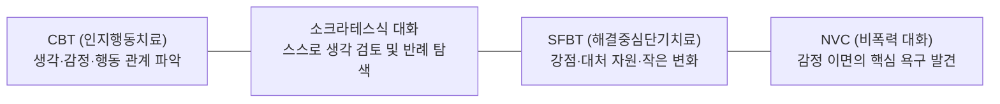

# 테슬랑 AI 감정 대화 시스템 (Emotional Dialogue System)

[프로젝트 README](../../README.md) · [서비스 기획안](../service-overview.md) · [기능 명세서](../features.md) · [API 명세서](../api.md)

테슬랑 서비스의 핵심 엔진인 **AI 감정 대화 시스템**에 관한 독립 전문 문서 모음입니다.
단순한 일회성 위로나 조언을 넘어, 사용자가 자신의 내면을 명확히 들여다보고 인지적 유연성을 확보하며 건강한 대처 행동을 스스로 선택할 수 있도록 돕는 대화형 감정 케어 시스템을 정의합니다.

---

## 1. 핵심 철학 및 가치

> **“나를 대신해 해결해주는 서비스가 아니라, 나의 감정을 이해하도록 돕는 대화”**

- **일방적 조언 지양:** AI가 정답이나 해결책을 지시하지 않고, 질문을 통해 사용자가 생각을 확장하도록 지원합니다.
- **감정의 언어화와 명료화:** 모호한 고통을 구체적인 감정 단어와 상황(Situation)으로 분리합니다.
- **자동적 사고 탐색:** 감정을 유발한 최초의 생각(Thought)을 들여다보고, 새로운 대안적 관점(Alternative Thought)을 발견합니다.
- **내면 욕구 및 강점 발견:** 비폭력대화(NVC)와 해결중심단기치료(SFBT)를 통해 진정한 욕구와 과거의 대처 능력(coping)을 일깨웁니다.
- **실천 가능한 작은 행동:** 스스로 시도할 수 있는 현실적인 작은 행동(Action)을 도출합니다.
- **절대적 안전 최우선:** 위기 신호(자해, 자살, 타해, 폭력) 감지 시 대화를 즉시 중단하고 전문 핫라인으로 연계합니다.

---

## 2. 문서 체계 및 목차

감정 대화 시스템은 다음 5개의 전문 문서로 구성되어 있습니다.

| 문서 | 핵심 내용 | 주요 대상 독자 |
| :--- | :--- | :--- |
| **[1. 상담 프로세스 명세 (process.md)](process.md)** | STEP 01~07 단계별 목적, 핵심 질문 예시, 수집 데이터 규약, 단계 전이 규칙 | 기획자, 프롬프트 엔지니어, BE 개발자 |
| **[2. 위기 대응 및 안전 가드레일 (safety.md)](safety.md)** | 위기 대응 6대 규칙, 서버 1차 + AI 2차 이중 감지, 핫라인 연계, AI 금지 사항, `risk_flag` 격리 | 백엔드 개발자, 보안/안전 담당자 |
| **[3. BE 대화 제어 및 아키텍처 (design.md)](design.md)** | 백엔드의 대화 상태 머신 통제, 문맥(Context) 구성, 실패 처리 및 복구 | 백엔드 아키텍트, 서버 개발자 |
| **[4. 심리 상담 기법 조사 및 이론적 근거 (research.md)](research.md)** | CBT, 소크라테스식 대화법, SFBT, NVC의 이론적 배경과 서비스 적용 원리 | 서비스 기획자, 심리 자문, AI 연구자 |
| **[5. 대화 평가 프레임워크 (evaluation.md)](evaluation.md)** | 공개 벤치마크(ESConv, CBT-Bench 등), 자체 시나리오, 자동/인간 평가 기준 | QA, AI 엔지니어, 평가 담당자 |

---

## 3. 4대 통합 심리 상담 기법 요약



- **CBT:** 자동적 사고를 포착하고 사건과 해석을 분리
- **소크라테스 대화법:** "그렇게 생각하게 된 이유는 무엇인가요?", "다른 가능성은 없을까요?" 같은 개방형 질문
- **SFBT:** "문제가 조금 덜했던 순간은 언제였나요?", "어떻게 버텨올 수 있었나요?" 등 자원 탐색
- **NVC:** "그때 진정으로 바랐던 것은 무엇이었나요?"를 통한 욕구 수용

---

## 4. 7단계 대화 라이프사이클 요약

```
[STEP 01] 감정 및 상황 탐색 (Situation)
   ➔ [STEP 02] 감정과 상황 구조화 (Emotion, Pre-Intensity 0~10, Trigger, Thought)
      ➔ [STEP 03] 생각의 유연성 탐색 (Alternative Thought, Need)
         ➔ [STEP 04] 해결 가능성 발견 (coping)
            ➔ [STEP 05] 감정 정리 및 실천 (Action)
               ➔ [STEP 06] 말랑이 추천 및 환기 (Post-Intensity 0~10, Malangi)
                  ➔ [STEP 07] 감정 기록 영구 저장 (마음 기록함)
```

상세한 각 단계별 가이드와 프롬프트 제어 규칙은 **[process.md](process.md)**를 참조하세요.
위기 상황 발생 시 안전 조치는 **[safety.md](safety.md)**를 참조하세요.
