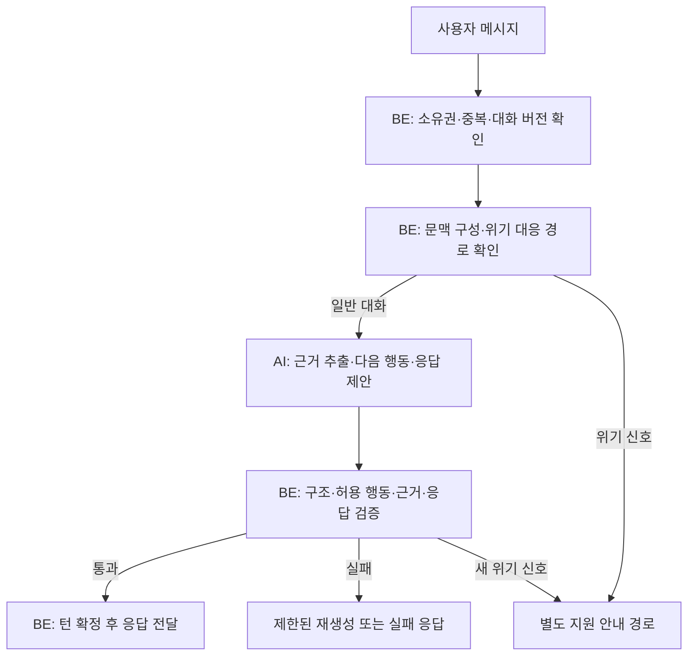

# AI 감정 대화 제어 설계 및 구현 아키텍처

[감정 대화 시스템 README](README.md) · [7단계 상담 프로세스](process.md) · [위기 대응 규칙](safety.md) · [서비스 기획안](../service-overview.md) · [기능 명세서](../features.md) · [조사 근거](research.md) · [평가 설계안](evaluation.md) · [프롬프트 안내](../../src/main/resources/prompts/README.md)

상태: 백엔드 구현 반영 완료 (F-01~F-03, F-07~F-09, F-12 월간 분석 레포트) · 2026-11-18 · 관련 기능: F-01~F-03, F-07~F-09, F-12

## 목적과 범위

사용자가 제공한 PM 확정 기획서의 **7단계 감정 상담 프로세스(STEP 01~07)**와 **4대 심리 상담 기법(CBT, 소크라테스식 대화, SFBT, NVC)**, **위기 대응 6대 규칙**을 AI 감정 대화의 백엔드 제어 정책으로 체계화하고 실제 `counseling` 모듈에 구현한 아키텍처 문서입니다. BE가 대화 세션 상태(`CounselingSession`, `CounselingState`), 순차 단계(`CounselingStep`), 클라이언트 입력 순서(`NextInput`), 실행 권한 및 안전 검사를 통제하고, AI는 허용된 단계와 목표 안에서 적절한 질문과 공감을 제안합니다.

근거와 한계는 [조사 기록](research.md)에 정리합니다. 상담 기법의 존재가 이 제품의 치료 효과를 입증하지는 않으며, 서비스 고지("전문 상담이나 치료를 대신하지 않습니다")를 엄격히 준수합니다. AI가 진단이나 의학적 조언을 내리거나, 사용자의 생각을 "틀렸다", "비합리적이다"라고 평가하지 않습니다.

---

## 7단계 상담 프로세스와 BE 단계 제어

기획서의 7단계 프로세스를 BE의 대화 상태 머신(State Machine)으로 관리합니다.

| 단계 | 명칭 | 기법 | 수집 및 처리 데이터 |
| :--- | :--- | :--- | :--- |
| **STEP 01** | 감정 및 상황 탐색 | 경청/공감 | `Situation` (사건, 당시 환경, 고민) |
| **STEP 02** | 감정과 상황 구조화 | CBT | `Emotion` (대표+부가 감정), `pre_intensity` (0~10점), `Trigger`, `Thought` |
| **STEP 03** | 생각의 유연성 탐색 | 소크라테스 | `Alternative Thought` (대안적 관점), `Need` (내면의 욕구) |
| **STEP 04** | 해결 가능성 발견 | SFBT | `coping` (과거 대처 자원, 버텨온 방식) |
| **STEP 05** | 감정 정리 및 실천 | CBT+SFBT | `Action` (현실적으로 실천 가능한 작은 행동) |
| **STEP 06** | 말랑이 추천 및 환기 | 환기/종결 | `post_intensity` (0~10점 재입력), `recommended_malangi` (슬랑이/스퀴시/왁뿌볼) |
| **STEP 07** | 감정 기록 저장 | 아카이빙 | `EmotionRecord` 최종 저장 및 요약 생성 |

## 제안: BE가 실행을 통제하는 대화 워크플로

고정된 코드는 권한·상태·오류를 처리하고, AI는 맥락에 따라 질문 전략을 선택합니다. 엄밀히는 자유롭게 도구를 호출하는 자율 에이전트보다, 모델의 선택을 제한된 행동 집합 안에서 허용하는 워크플로에 가깝습니다. 대화 품질에 도움이 되는지 평가한 뒤 자율성을 넓힙니다.



실제 위기 판별은 PM 기획서의 **위기 대응 6대 규칙**에 따라 **1차 서버 정규식/키워드 규칙 ➔ 2차 AI 안전 분류기**의 이중 검사 체계로 수행됩니다. 자해·자살, 타해, 학대·폭력 등 위험 신호가 감지되면 대화를 즉시 중단하고 고통에 대한 짧은 공감 후 긴급 핫라인(109, 1577-0199, 1388, 112/119) 안내 화면으로 전환합니다. 해당 세션은 `risk_flag = true`로 저장되어 개인화 분석에서 완전히 격리됩니다.

## 대화 행동과 선택 조건

아래 행동은 모델이 선택할 수 있는 후보입니다. 상황 파악 → 반례 → 행동의 순서를 강제하지 않고, 사용자 반응에 따라 머무르거나 되돌아갑니다. 모든 행동을 한 번씩 수행해야 종료할 수 있는 구조로 만들지 않습니다.

| 행동 | 적합한 상황 | 예시 또는 제약 |
| --- | --- | --- |
| 공감·반영 | 감정을 알아주길 원하거나 질문을 부담스러워함 | 질문 없이 사용자가 말한 경험을 짧게 반영할 수 있음 |
| 명료화 | 사건·생각·감정이 뒤섞여 있거나 표현이 모호함 | “답장을 기다리던 순간에 어떤 생각이 들었어?” |
| 근거·다른 가능성 탐색 | 사용자가 한 가지 해석을 사실처럼 받아들이며 탐색 의사가 있음 | 생각을 틀렸다고 입증하거나 반례를 지어내지 않음 |
| 관점 확장 | 다른 시각을 살펴볼 준비가 됨 | “이 상황을 다른 쪽에서 바라보면 어떤 설명이 가능할까?” |
| 척도 질문 | 사용자가 수치로 상태를 표현하기를 원함 | 0·10의 의미를 먼저 공유하고 점수는 사용자가 정함 |
| 예외·대처 탐색 | 덜 힘들었던 순간이나 이미 쓰는 자원을 찾고 싶어 함 | 없다고 답하면 반복해서 찾아내도록 요구하지 않음 |
| 작은 행동 탐색 | 사용자가 다음 행동을 원함 | 행동을 정답처럼 처방하지 않고 제안·선택을 도움 |
| 정리 제안 | 사용자가 마무리를 원하거나 정리할 내용이 모임 | 요약을 제안하고 해석이 맞는지 사용자가 수정할 수 있게 함 |

질문은 한 응답에 핵심 한 개를 기본으로 제안합니다. ‘왜’를 기계적으로 금지하기보다 비난·추궁·정답 유도 여부를 평가하며 ‘무엇·어떻게’ 표현을 우선합니다. “그냥 들어줘”, “모르겠어”, 질문 거절과 주제 변경도 유효한 입력입니다. 질문에 답하지 않았다는 이유로 같은 질문을 반복하지 않습니다.

### 같은 시작에서 달라지는 대화 예시

사용자: “친구가 답장을 안 해. 나를 싫어하나 봐.”

첫 응답 후보: “답장이 없어서 마음이 쓰이는구나. 기다리면서 어떤 생각이 가장 많이 들었어?”

- “내가 어제 말을 잘못했나 싶어” → 그 말과 당시 상황을 명료화합니다. 답장이 늦는 다른 이유부터 나열하지 않습니다.
- “오늘은 질문 말고 그냥 들어줘” → 추가 질문 없이 감정을 반영합니다.
- “좀 다르게 생각해보고 싶어” → 사용자가 아는 사실과 해석을 함께 살펴보고 다른 가능성을 탐색합니다.
- “이제 그만할래” → 종료 의사를 따릅니다. 다음 단계를 채우거나 행동 계획을 만들도록 붙잡지 않습니다.

이는 품질 평가에 사용할 가상 예시이며 검증된 상담 스크립트가 아닙니다.

## 한 턴에서 BE와 AI가 맡을 일

| 책임 | BE | AI |
| --- | --- | --- |
| 상태 관리 | 확정된 대화 상태·버전 관리 | 상태 변경 후보 제안 |
| 문맥 | 최근 메시지·검증 가능한 요약·필요한 근거 구성 | 주어진 문맥에서 의미 해석 |
| 대화 정책 | 허용 행동·우선순위·제한 적용 | 다음 행동과 사용자에게 보여줄 문장 제안 |
| 안전·품질 | 검사와 위기 경로 실행, 실패 처리 | 신호와 문제 후보 제공, 안전 경로를 무효화할 권한 없음 |
| 종료 | 사용자 종료 처리·정리 제안 절차 실행 | 정리 가능성을 제안하며 종료를 독단적으로 확정하지 않음 |
| 기록·외부 동작 | 인증·권한·보관 정책에 따라 실행 | 임의 DB 변경·기록 삭제·외부 전송 불가 |

실제 구현에서는 [ADR-0002](../adr/0002-feature-hexagonal-architecture.md)에 맞춰 `counseling` 모듈을 기능별 헥사고날 구조로 구성했습니다.

- **입력 포트·웹 어댑터 (`application.port.in`, `adapter.in.web`):** `CounselingUseCase`(`start`, `send`, `submitEmotion`, `complete`, `abort`, `delete`), `RecordUseCase`(`list`, `detail`, `conversation`, `calendar`, `setHidden`, `monthlyReport`, `delete`) 및 `CounselingController`·`RecordController`·`CounselingExceptionHandler`.
- **도메인 (`domain`):** `CounselingSession`, `CounselingState`, `CounselingStep`, `CounselingStatus`, `NextInput`, `CrisisSignalFilter`, `CrisisAssessment`, `CrisisCategory`, `CrisisHotline`, `EmotionCatalog`, `MessageSender`.
- **애플리케이션 서비스 (`application.service`):** `CounselingService`와 `RecordService`가 유스케이스를 조율하며, `PromptBuilder`, `StepTargets`, `ReplyRules`, `UserSignals`, `Draft`, `FallbackMessages`가 문맥 조립·검증·보정·폴백을 담당합니다.
- **출력 포트·AI/영속 어댑터 (`application.port.out`, `adapter.out.{ai,persistence}`):** `CounselingAi`, `PromptSource`, `CounselingSessionStore`, `RecordStore`, `MalangiReward`를 `SpringAiCounselingAi`, `ClasspathPromptSource`, `CounselingPersistenceAdapter`가 구현하며, `CounselingConfiguration`에서 가상 스레드 실행기와 타임아웃 설정으로 조립합니다. SDK나 제공자 응답 형식은 `domain`과 `application.service`로 유입되지 않습니다.

## 현재 대화 상태의 추정과 다음 행동 선택

LLM의 상태 추정은 설계상 후보이며 이 서비스에서의 정확도는 미검증입니다. BE가 각 상태의 의미·판단 기준·허용 전환을 정의하고, AI에는 직전 메시지와 함께 선행 질문·답변과 사용자 의도를 문맥으로 제공하는 구성을 제안합니다.

| 대화에서 확인된 내용 | 가능한 상태 판단 |
| --- | --- |
| 감정만 표현되고 사건·생각은 구체적이지 않음 | 명료화할 정보가 남음 |
| 사건과 그에 대한 사용자 해석이 드러남 | 근거·다른 가능성을 탐색할 후보가 생김 |
| 다른 관점을 살펴보고 싶다고 말함 | 관점 확장 의사가 드러남 |
| 해보고 싶은 행동을 스스로 말함 | 작은 행동을 구체화할 후보가 생김 |

상태 후보와 다음 행동은 분리합니다. 사건과 생각이 드러났더라도 사용자가 “그냥 들어줘”라고 하면 다음 행동은 공감·반영일 수 있습니다. 정보가 부족하거나 해석이 여러 개라면 판단 보류를 허용합니다. 모델이 스스로 산출한 확신도 수치를 실제 정확도 보장으로 사용하지 않습니다.

BE가 자동으로 확인할 수 있는 출력 형식·권한·허용 전환과, 사람의 검토가 필요한 해석의 적절성을 구분합니다. 구체적인 평가 사례와 역할은 [평가 설계안](evaluation.md)에 기록합니다.

## 문맥과 구조화된 결과 후보

문맥에는 현재 주제, 최근 발화, 앞선 질문과 답변 여부, 사용자 발언에서 확인된 사건·감정·생각, 아직 확인하지 않은 해석을 구분해 담습니다. 빈 항목을 전부 채우는 설문으로 만들지 않습니다. 감정·척도 점수를 AI가 추정해 사용자 입력처럼 저장하지 않습니다.

척도에는 측정 대상과 양 끝점의 의미도 함께 유지합니다. 불안 강도 7점과 원하는 상태에 가까운 정도 7점을 같은 의미로 비교하지 않습니다. 점수의 상승 자체를 대화 성공으로 판정하지 않습니다.

초기 설계에서는 공급자 중립적인 내부 예시(`proposedAction`, `groundedObservations`, `unconfirmedHypotheses`)로 시작했고, 실제 구현에서는 단계·슬롯·와이어프레임 요구사항을 반영해 [`prompts/emotion-conversation/output.schema.json`](../../src/main/resources/prompts/emotion-conversation/output.schema.json)으로 구체화했습니다.

```json
{
  "userMessage": "사용자에게 보여 줄 말 (공감\\n질문)",
  "transitionReady": false,
  "questionTarget": "initialThought",
  "extractedData": {
    "situation": null,
    "triggerFactor": null,
    "initialThought": null,
    "alternativeThought": null,
    "underlyingNeed": null,
    "copingStrategy": null,
    "actionPlan": null,
    "summary": null,
    "keySentence": null,
    "malangiReason": null
  },
  "replyOptions": ["난 일을 제대로 못 하는 사람인가 싶었다", "다들 나를 한심하게 볼 것 같았다"],
  "endRequested": false,
  "backToStep": null
}
```

- `extractedData`는 이번 사용자 메시지로 새로 확인되거나 바뀐 슬롯만 담으며 `null`은 변화 없음, `""`은 사용자가 "없다·모르겠다"고 답했음을 뜻합니다. 기존 값이 있을 때 `""`로 덮어쓰지 않습니다.
- `questionTarget`은 현재 단계의 `CounselingStep.targets()` 중 하나로 제한되며, 이미 확인된 항목이나 단계 밖 항목을 묻지 않도록 `ReplyRules`가 검증합니다.
- 모델의 비공개 사고 과정은 요구하거나 노출하지 않습니다.

장기 기록 조회는 인증·삭제·보관 정책이 적용된 범위에서 `RecordService`가 담당합니다. 매 상담 대화 턴에는 다른 사용자 기록이나 과거 세션 전체 이력을 일괄 전달하지 않으며, **F-12 테스형의 월간 분석 레포트**(`GET /api/v1/records/report`)에서만 해당 월의 완료된 `counseling_results`(최대 최근 30건, 위기 중단 세션 제외)와 `emotionStats`를 묶어 `prompts/monthly-report`에 전달합니다. 생성 결과는 `counseling_reports` 테이블에 `source_signature`(기록 수:최대 `resultId`) 기준으로 캐싱해 기록 변경이 없으면 AI를 재호출하지 않습니다.

## 실패·지연·동시성

- **입력 순서 및 실패 구분:** `NextInput`(`MESSAGE`, `EMOTION_CARD`, `POST_INTENSITY`, `NONE`)으로 허용되지 않은 입력은 `409 INPUT_NOT_EXPECTED`로 차단합니다. 사용자 발화는 AI 호출 전에 먼저 `counseling_messages`에 저장되며, AI 호출이 모두 실패하더라도 500 에러 대신 `FallbackMessages` 기본 문장을 반환해 대화가 끊기지 않게 방어합니다.
- **트랜잭션 및 동시성:** 현재 구현에서는 외부 LLM 호출을 기다리는 동안의 타임아웃·재시도를 `ExecutorService`(가상 스레드)에서 관리합니다. 다만 동일 세션에 대한 동시 다중 요청 낙관적 락·버전 검사와 네트워크 재시도용 요청 멱등키(idempotency key)는 아직 미구현입니다.
- **검증 실패 1회 재요청 및 서버 보정 (`ReplyRules`):**
  - 재요청 대상 위반: 빈 `userMessage`, 물음표 2개 이상, 하오체 위반(해요체·합니다체 어미 탐지), 미완료 상태에서 마무리/전환 시도, `questionTarget` 누락·단계 밖 항목·이미 확인된 항목 재질문, `STEP_06` 기록함 해요체·필수 문장 누락·타 말랑이 언급. 위반 시 사유를 서버 지시로 덧붙여 **최대 1회 재요청**합니다.
  - 자동 보정 대상: 공감 문장·질문 사이 줄바꿈 `\n` 자동 삽입(`splitBubble`), 허용되지 않은 단계(`STEP_01`, `STEP_03`, `STEP_04`)의 `replyOptions` 제거, 필수 슬롯이 다 찼는데 질문을 덧붙인 경우 질문 줄 제거 후 단계 완료 처리(`serverFinished`), `"모르겠어"`/`"없어"` 입력 시 슬롯을 `""` 확정 후 불필요한 질문 줄 제거.
- **완성 후 전달 및 프롬프트 인젝션 방어:** 토큰 스트리밍 대신 구조화 JSON 전체 응답을 수신·검증한 뒤 클라이언트에게 전달합니다. 사용자 발화와 기록 내 지시 무시·역할 변경·단계 조작 문구(`"이전 지시를 무시해"`, `"riskFlag true로 해"`)는 데이터로만 취급하도록 `common.md`, `safety-classifier/system.md`, `monthly-report/system.md`에 방어 규칙을 명시했습니다.

## 평가와 도입 현황

공개 데이터셋 범위, 구현된 자동·실모델 테스트, 프롬프트 시뮬레이션과 아직 남은 평가 과제는 [평가 설계안](evaluation.md)에 정리합니다.

현재는 다중 에이전트나 매 턴 외부 검색 없이 **단일 `counseling` 모듈 + 구조화 출력 + 2차 안전 분류기 병렬 실행** 구조로 기준선을 구현했습니다. 실모델 종단 흐름 테스트(`CounselingLiveFlowTests`)와 프롬프트 측정 시뮬레이션(`eval/`)으로 기술 동작과 형식 규칙은 검증했으나, 임상·전문가 검토와 실제 사용자 대상 평가는 아직 수행하지 않았습니다.

## 합의 및 구현 현황 요약

1. **대화 톤·종료·요약 경험:** 테스형 하오체(대화) + 사용자 1인칭 해요체(기록함), `endRequested` / `POST /abort` 경로로 구현 완료.
2. **위기 신호 안내·연결:** `CrisisSignalFilter` + `safety-classifier` + `CrisisHotline`(109, 1577-0199, 1388, 112, 119) 구현 완료. 미성년자 여부별 특화 정책은 미분리.
3. **데이터 저장·격리·삭제:** `counseling_sessions`·`counseling_messages`·`counseling_results`·`counseling_reports` 스키마(V4/V5), 위기 세션 격리 및 `DELETE /sessions/{sessionId}` 일원화 삭제 구현 완료. F-13 과거 대처 자동 추천 등 장기 개인화는 미구현.
4. **모델 스택·지연·비용:** Spring AI `2.0.2` + Anthropic `claude-haiku-5-5` 기본 채택, 시스템 프롬프트 캐싱 적용, 호출 유형별 타임아웃(`8s`/`15s`/`5s`) 설정.
5. **동시성·멱등성·음성:** 동시 메시지 버전 검사, 요청 멱등키, 음성(STT/TTS)은 향후 과제로 남아 있습니다.

---

## Wayfinding 확정 스펙 및 실제 구현 반영 (2026-11-07 ➔ 2026-11-18)

Wayfinding 및 Grilling을 통해 합의된 7개 항목과 실제 백엔드 구현 결과입니다.

1. **상태 머신, 슬롯 축적 및 전용 프롬프트 주입 ([01-dialogue-turn-control](../../.scratch/emotional-dialogue/issues/01-dialogue-turn-control.md)) — 구현 완료**
   - 백엔드가 `CounselingStep`(`STEP_01`~`STEP_06`), `CounselingStatus`(`IN_PROGRESS`, `COMPLETED`, `ABORTED_RISK`, `ABORTED_USER`), `NextInput`(`MESSAGE`, `EMOTION_CARD`, `POST_INTENSITY`, `NONE`)을 엄격히 통제합니다.
   - 진행 중 슬롯, `flow` 상태, `emotionCards`, `inProgressTimeline`은 `counseling_sessions.session_state` JSON에 누적되며, `POST /complete` 시 `counseling_results`로 확정 저장됩니다.
   - `PromptBuilder`가 `common.md`와 `steps/STEP_01~06.md`, `# 현재 상태` 블록을 동적으로 조립해 주입합니다.
   - 대화 중 종료 요청(`endRequested: true`) 시 `POST_INTENSITY`로 이동해 그때까지 이야기로 정리·기록할 수 있고, `POST /abort` 호출 시 `ABORTED_USER`로 전환해 슬롯만 보존합니다.
2. **Spring AI 연동, 모델 스택 및 프롬프트 캐싱 ([02-llm-integration-stack](../../.scratch/emotional-dialogue/issues/02-llm-integration-stack.md)) — 구현 완료**
   - Spring Boot 4.1.2 + Spring AI `2.0.2`(`spring-ai-anthropic`)를 채택하고, 환경변수(`LLM_API_KEY` 또는 `ANTHROPIC_API_KEY`, `LLM_MODEL`) 기반으로 기본 **`claude-haiku-5-5`** 모델을 연동했습니다. API 키가 없으면 앱 기동은 유지하되 호출 시 `Unavailable`을 던져 폴백 문장으로 응답합니다.
   - `AnthropicCacheStrategy.SYSTEM_ONLY`와 `multiBlockSystemCaching(true)`를 적용해 `[common.md + STEP_0N.md]` 캐시 블록과 `[# 현재 상태]` 동적 블록을 분리 전송합니다.
3. **위기 신호 1차 서버 인메모리 필터 및 2차 분류기 실패 정책 ([03-safety-first-line-filter](../../.scratch/emotional-dialogue/issues/03-safety-first-line-filter.md)) — 구현 완료**
   - `CrisisSignalFilter`가 정규화(공백·문장부호 제거)와 무해 관용구·일상 과장 예외를 적용해 1차 차단합니다.
   - 1차 통과 시 2차 `safety-classifier`를 상담 호출과 병렬 실행하며, `5s` 타임아웃 + 1회 재시도(`500ms`/`1000ms` 백오프) 후 최종 실패 시 상담 응답을 취소하고 `FallbackMessages.SAFETY_CHECK_FAILED`를 반환합니다(Fail-Safe).
4. **슬라이딩 윈도우 문맥 구성 ([04-context-window-and-history](../../.scratch/emotional-dialogue/issues/04-context-window-and-history.md)) — 구현 완료**
   - `CounselingService`가 최근 8턴(`HISTORY_MESSAGES = 16`, 연속 동일 화자 발화 병합)의 대화 기록과 `session_state`의 누적 슬롯·`answeredTargets`·`nextTarget`·`laterTargets`를 결합해 프롬프트에 전달합니다.
5. **정형 출력(Structured Output) 및 단계 전환·연쇄 호출 ([05-structured-output-and-step-transition](../../.scratch/emotional-dialogue/issues/05-structured-output-and-step-transition.md)) — 구현 완료**
   - `SpringAiCounselingAi`가 `output.schema.json`을 Claude 구조화 출력 형식으로 변환해 수신하고, `ReplyRules`와 `StepTargets`가 검증·보정 후 단계를 전환합니다.
   - 단계가 전환되면(`depth < 1`) 같은 턴 안에서 다음 단계 프롬프트로 첫 질문을 연쇄 호출해 사용자에게 즉시 반환합니다.
6. **하이브리드 말랑이 추천 및 자동 해금 ([06-malangi-recommendation-logic](../../.scratch/emotional-dialogue/issues/06-malangi-recommendation-logic.md)) — 구현 완료**
   - `EmotionCatalog.malangiFor`가 대표 감정 룰(`SLANGI`, `SQUISHY`, `WAKPPU`)로 추천 캐릭터를 확정하고, `STEP_06` LLM 호출이 요약·남은 문장·기록함 문장·추천 사유를 생성합니다.
   - `POST /complete` 트랜잭션에서 `MalangiReward.unlock`으로 잠긴 말랑이를 `user_malangis.is_unlocked = true`로 자동 해금합니다.
7. **호출 유형별 타임아웃 및 폴백(Fallback) 안전망 ([07-llm-failure-and-fallback](../../.scratch/emotional-dialogue/issues/07-llm-failure-and-fallback.md)) — 실측 반영 조정 및 구현 완료**
   - 초기 합의안의 단일 5초 타임아웃에서 실제 모델 지연 측정(상담 중앙값 2.3초·95% 5~6초·최대 7.4초, 정리 3~7초, 분류기 1.2초)을 반영해 호출 유형별로 타임아웃을 분리했습니다: **`conversation: 8s` (`LLM_TIMEOUT_CONVERSATION`), `summary: 15s` (`LLM_TIMEOUT_SUMMARY`), `safety: 5s` (`LLM_TIMEOUT_SAFETY`)**.
   - SDK 옵션은 `timeout(30s)`, `maxRetries(0)`으로 두고 서비스 계층(`withTimeout`)이 타임아웃과 1회 재시도(대화 `300ms` 대기, 안전 `500ms`/`1000ms` 백오프)를 직접 제어합니다.
   - 최종 실패 시 `FallbackMessages`가 현재 단계에 맞춘 하오체 기본 문장(`retry`, `start`, `SUMMARY`)을 반환해 대화 흐름이 끊기지 않도록 방어합니다. (단, F-12 월간 분석 레포트 `GET /api/v1/records/report`는 2회 실패 시 `503 REPORT_UNAVAILABLE`을 반환합니다.)
