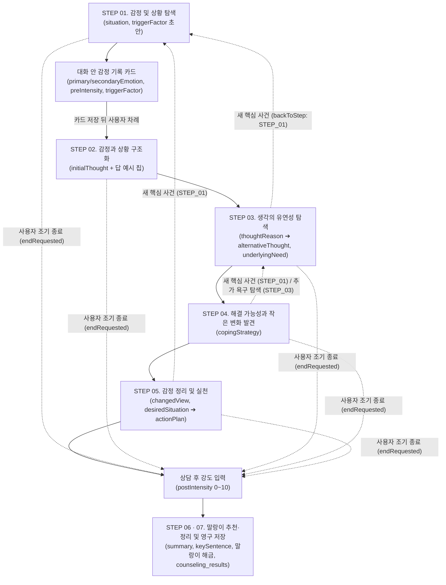

# 7단계 AI 감정 상담 프로세스 명세 (Dialogue Process)

[감정 대화 시스템 README](README.md) · [위기 대응 규칙](safety.md) · [대화 제어 아키텍처](design.md) · [데이터베이스 설계](../database.md) · [프롬프트 안내](../../src/main/resources/prompts/README.md)

AI 감정 상담의 7개 단계(STEP 01 ~ STEP 07)에 대한 상세 요구사항, 수집 데이터 규약, 핵심 발화 및 단계 전이 규칙을 정의합니다.

> **구현 반영 기준 (2026-11-18):** 와이어프레임(2026-11-14)과 `CounselingStep`·`prompts/emotion-conversation` 구현을 반영했습니다. 백엔드 단계 열거형은 `STEP_01`~`STEP_06`이며, 기획상의 `STEP 07`(영구 저장)은 `POST /complete`에서 `STEP_06` 정리와 함께 원자적으로 수행됩니다.

---

## 1. 전체 프로세스 흐름도 및 캐릭터 톤

- **AI 캐릭터와 말투:** 소크라테스를 닮은 **"테스형"**으로, 차분하고 다정한 **하오체**(`~소`, `~구려`, `~겠소?`)를 사용합니다. (아래 단계별 질문 예시는 기획안 원문이며, 실제 프롬프트는 이를 하오체로 변환해 출력하고 공감 문장과 질문 문장 사이를 줄바꿈 `\n`으로 분리해 말풍선을 나눕니다.)
- **기록함 문체 구분:** 대화 중 테스형의 발화는 하오체이지만, `STEP_06`에서 생성해 마음 기록함·추천 화면에 저장하는 문장(`summary`, `keySentence`, `record.initialThought`, `record.alternativeThought`)은 **사용자 1인칭 해요체**(`~요.`)로 작성합니다(`actionPlan`은 `~하기` 형태 허용).
- **입력 순서 제어 (`NextInput`):** 서버가 매 턴 다음에 기대하는 클라이언트 입력(`MESSAGE` ➔ `EMOTION_CARD` ➔ `MESSAGE` ➔ `POST_INTENSITY` ➔ `NONE`)을 내려 줍니다.

---

## 2. 단계별 상세 명세

### STEP 01. 감정 및 상황 탐색 (Situation)

- **목적:** 사용자가 자신의 고민과 상황을 부담 없이 편안하게 표현하도록 유도
- **상담 기법:** 공감적 경청, 개방형 질문
- **물을 것(`questionTarget`) / 필수 슬롯:** `situation` (필수)
- **수집 데이터:**
  - `situation` (문자열): 사용자가 겪은 구체적인 사건, 시점, 주변 환경 및 핵심 어려움
  - `triggerFactor` (문자열): 완료 시 감정 기록 카드의 "유발 상황" 기본값으로 채울 직접적 계기
  - (선택 선행 추출) 첫 메시지에 최초 생각(`initialThought`)이나 바랐던 것(`underlyingNeed`)이 이미 드러나면 함께 채워 이후 단계에서 중복 질문을 피합니다.
- **시스템 지침:**
  - 사용자의 발화를 평가하거나 해결하려 들지 않고, 온전히 경청하고 수용합니다.
  - "왜 그랬어요?" 같은 추궁형 어조를 지양하고 "무슨 일이 있었나요?", "어떤 상황이었나요?"의 표현을 사용합니다.
  - 첫 메시지가 한 문장뿐이고 구체적 사건이 없으면 완료하지 않고 상황을 한 번 더 묻습니다.
  - 상황이 충분히 드러나면 받아 주는 한 문장 + 감정을 먼저 같이 정리해 보자는 한 문장("그때의 감정을 먼저 같이 정리해 보면 좋을 것 같소.")만 작성하고 질문하지 않습니다.
- **핵심 질문 예시 (기획안 참고):**
  > “그 상황에서 마음이 불편했던 일이 있었나요?”
  > “그 일이 있고 나서 계속 생각나는 장면이나 순간이 있나요?”
- **다음 단계 전이 조건:** `situation`이 확인되면 서버가 `nextInput: EMOTION_CARD`를 반환해 대화 안 **감정 기록 카드**를 노출합니다.

---

### [전환 카드] 대화 안 감정 기록 카드 (`POST /emotion`, STEP 01 ➔ STEP 02)

- **UI·API 흐름:** 사용자가 카드에서 **대표 감정 1개**(`속상함`, `불안함`, `분노`, `억울함`, `슬픔`, `서운함`), **부가 감정 1개(선택)**(`답답함`, `외로움`, `허무함`, `서운함`, `억울함`), **사전 감정 강도(`preIntensity`, 0~10)**를 직접 고르고, 필요 시 `triggerFactor`를 수정해 제출합니다.
- **카드 저장 직후 동작:** 카드는 대화 기록에 `SYSTEM` 메시지(`(감정 기록: 대표, 부가 / 강도 N)`)로 남으며, 테스형이 먼저 말을 걸지 않습니다(`aiMessage: null`, `nextInput: MESSAGE`, `cardFresh: true`). 사용자가 이어서 보낸 메시지가 `STEP 02`의 첫 대화가 됩니다.
- **선행 슬롯 충족 시 건너뛰기:** 앞선 대화에서 `initialThought` 등 이후 단계의 필수 슬롯이 이미 모두 채워졌다면, `StepTargets.stepDone` 판단에 따라 완료된 단계를 건너뛰고 다음 미완료 단계(모두 완료 시 `POST_INTENSITY`)로 이동합니다.

---

### STEP 02. 감정과 상황 구조화 (CBT)

- **목적:** 카드에서 고른 감정과 상황을 바탕으로, 감정을 자극한 계기와 그 순간 떠오른 최초의 자동적 사고를 구조화
- **상담 기법:** 인지행동치료(CBT) 감정·사고 분리
- **물을 것(`questionTarget`) / 필수 슬롯:** `initialThought` (필수), `triggerFactor` (선택 — 상황으로 이미 분명하면 묻지 않음)
- **수집 데이터:**
  - `primaryEmotion`, `secondaryEmotion` (선택), `preIntensity` (0~10): 감정 기록 카드에서 사용자 직접 입력 (AI가 추정하거나 다시 묻지 않음)
  - `triggerFactor` (문자열): 감정을 자극한 직접적인 계기
  - `initialThought` (문자열): 그 순간 머릿속에 가장 먼저 스친 생각 (자기 자신·상황 평가 포함)
- **시스템 지침:**
  - **감정 강도(`preIntensity`)와 감정은 AI가 임의로 추정하지 않고 감정 기록 카드에서 사용자가 직접 입력합니다.**
  - 카드 저장 후 사용자의 첫 발화와 고른 감정을 함께 받아 주며, 확인된 `situation`·`triggerFactor` 맥락을 넣어 최초 생각을 묻습니다(단계 프롬프트 예시의 사건을 섞어 쓰지 않음).
  - `initialThought` 질문 시 사용자가 눌러 고를 수 있는 **답 예시 칩(`replyOptions`) 2개**를 사용자 사건 맥락에 맞게 제공합니다(사용자는 칩 선택 또는 직접 입력 가능).
  - 그렇게 생각한 이유(`thoughtReason`)는 STEP 03에서 묻습니다.
- **핵심 질문 예시 (기획안 참고):**
  > “그 감정이 올라오던 순간 머릿속에 가장 먼저 스친 생각은 무엇이었나요?”
- **다음 단계 전이 조건:** `initialThought`가 확인(값이 있거나 `""`)되면 `STEP 03`으로 전이하고, 서버가 같은 턴 안에 `STEP 03` 첫 질문을 생성해 함께 반환합니다.

---

### STEP 03. 생각의 유연성 탐색 (소크라테스식 대화법 & NVC)

- **목적:** 감정을 유발한 자동적 사고의 타당성을 부드럽게 점검하고, 그 생각 이면에 감추어진 진정한 내면 욕구를 발견
- **상담 기법:** 소크라테스식 산파술(근거 및 반례 탐색), 비폭력대화(NVC 욕구 파악)
- **물을 것(`questionTarget`, 순서):** `thoughtReason`(비슬롯 탐색 질문) ➔ `alternativeThought` (필수) ➔ `underlyingNeed` (필수)
- **수집 데이터:**
  - `alternativeThought` (문자열): 사건을 바라보는 새로운 대안적 관점·다른 이유나 사정
  - `underlyingNeed` (문자열): 감정이 가장 크게 올라온 순간 사용자가 진정으로 바랐던 핵심 욕구 (인정, 존중, 휴식, 안전 등)
- **시스템 지침:**
  - 사용자의 기존 생각을 "잘못되었다", "비합리적이다"라고 비판하거나 논박하지 않습니다.
  - `thoughtReason`은 `initialThought` 문장을 직접 인용해 묻고, 근거를 답하면서 다른 이유·사정을 이미 말했으면 `alternativeThought`에 바로 담아 중복 질문을 건너뜁니다.
  - `alternativeThought`는 추상적 질문 대신 사건을 넣어 구체적인 다른 이유나 사정을 묻습니다. **실제로 부당한 일이라 다르게 보기 어렵다고 하면 그대로 수용하고 `""`로 기록**하며 인지 오류로 돌리지 않습니다.
  - `replyOptions`는 사용하지 않습니다(AI가 다른 해석이나 욕구를 대신 제시·짐작하지 않음).
- **핵심 질문 예시 (기획안 참고):**
  > “그렇게 생각하게 된 데에는 어떤 이유나 근거가 있었나요?”
  > “혹시 상대방의 다른 사정이나, 내가 생각하지 못했던 다른 가능성이 있을 수도 있을까요?”
  > “그 상황에서 사실 가장 간절하게 바랐던 것은 무엇이었나요?”
- **다음 단계 전이 조건:** `alternativeThought`와 `underlyingNeed`가 모두 확인(값이 있거나 `""`)되면 `STEP 04`로 전이합니다.

---

### STEP 04. 해결 가능성과 작은 변화 발견 (SFBT)

- **목적:** 사용자가 이미 가지고 있는 내면의 힘, 대처 자원과 예외 상황을 일깨움
- **상담 기법:** 해결중심 단기치료(SFBT) 예외 질문, 대처 질문
- **물을 것(`questionTarget`) / 필수 슬롯:** `copingStrategy` (필수)
- **수집 데이터:**
  - `copingStrategy` (문자열): 지금까지 버텨 온 방법, 도움이 되었던 방법, 문제가 조금 덜했던 순간
- **시스템 지침:**
  - 사용자가 무기력함을 느끼지 않도록 이미 지금까지 잘 버텨온 자원을 찾아내어 인정합니다.
  - "딱히 없어", "모르겠어"라고 답하면 `""`로 확정하고 반복해서 찾아내도록 요구하지 않습니다. `replyOptions`는 사용하지 않습니다.
- **핵심 질문 예시 (기획안 참고):**
  > “이런 힘든 상황에서도 지금까지 어떻게 버텨올 수 있었나요?”
  > “이전에도 비슷한 힘듦이 있었을 때, 조금이라도 마음에 도움이 되었던 방법이 있었나요?”
  > “문제가 조금 덜 느껴졌던 순간이 있었다면 언제였나요?”
- **다음 단계 전이 조건:** `copingStrategy`가 확인(값이 있거나 `""`)되면 `STEP 05`로 전이합니다.

---

### STEP 05. 감정 정리 및 실천 (CBT + SFBT)

- **목적:** 정리된 새로운 생각과 자원을 바탕으로, 일상에서 즉시 실천해볼 수 있는 아주 작은 행동을 스스로 선택
- **상담 기법:** 인지 재구성 마무리 및 행동 활성화
- **물을 것(`questionTarget`, 순서):** `changedView`(비슬롯 탐색) ➔ `desiredSituation`(비슬롯 탐색) ➔ `actionPlan` (필수)
- **수집 데이터:**
  - `actionPlan` (문자열): 사용자가 직접 선택한 현실적인 작은 실천 행동
  - (보조 갱신) `changedView` 질문에 처음 생각과 달라진 관점을 말하면 기존 `alternativeThought` 뒤에 `" / "`로 이어 붙입니다. "조금 가벼워졌다" 같은 기분 표현만 있거나 달라진 게 없다고 하면 그대로 수용하고 `desiredSituation`으로 넘어갑니다.
- **시스템 지침:**
  - 거창하거나 부담스러운 목표가 아니라 "오늘 당장 5분 동안 할 수 있는 작은 행동"을 찾도록 유도합니다.
  - **`actionPlan`은 반드시 STEP 05에서만 확정합니다.** 앞 단계에서 나온 "~하고 싶어" 같은 바람을 실천 행동으로 간주해 STEP 05를 건너뛰지 않습니다.
  - 사용자가 행동을 떠올리지 못하면("모르겠어"/"없어") 1회에 한해 질문 대신 선택 가능한 작은 행동 2~3개를 `replyOptions`로 제시합니다(휴식 포함 가능).
  - 지금 당장 어떤 행동도 할 에너지가 없어 쉬고 싶다고 하면 `"오늘은 쉬기"`를 실천 행동으로 수용합니다.
  - 구체적인 행동이나 `replyOptions` 중 하나를 고르면 언제·어떻게 할지 확인 질문을 덧붙이지 않고 즉시 완료합니다.
- **핵심 질문 예시 (기획안 참고):**
  > “처음 생각과 비교했을 때, 지금 상황을 바라보는 마음에 달라진 부분이 있나요?”
  > “마음이 한결 편안해지기 위해, 오늘 당장 스스로에게 해줄 수 있는 아주 작은 행동은 무엇이 있을까요?”
- **다음 단계 전이 조건:** `actionPlan`이 확인되면 서버가 `nextInput: POST_INTENSITY`를 반환해 상담 후 감정 강도 입력 화면으로 전환합니다.

---

### STEP 06 · STEP 07. 말랑이 추천, 정리 및 영구 저장 (`POST /complete`)

- **목적:** 사용자가 입력한 사후 감정 강도를 반영해 대화를 정리하고, 감정 상태에 맞는 말랑이를 추천·해금하며, 전체 상담 결과를 `counseling_results`로 영구 저장
- **상담 기법:** 상담 종결 및 감각적 접지(Grounding) · 아카이빙
- **수집 및 생성 데이터:**
  - `postIntensity` (정수, 0~10): 사용자가 `POST /complete` 요청으로 직접 입력 (카드 전 조기 종료 시 `primaryEmotion`, `preIntensity` 함께 수신)
  - `recommendedMalangi` (문자열, **백엔드 도메인 룰 결정**): `SLANGI`, `SQUISHY`, `WAKPPU`
  - `userMessage` (테스형 하오체): 확인된 슬롯만 담아 상담을 짧게 정리 (질문 금지)
  - 마음 기록함·추천 화면 문장(**사용자 1인칭 해요체**, 슬롯에 있는 말만 사용):
    - `summary`: 마음 기록함 카드 제목 한 줄
    - `keySentence`: 추천 화면 "대화에서 남은 문장" (처음 생각과 새 관점을 잇는 문장, 비워 두지 않음)
    - `malangiReason`: 서버가 결정한 추천 말랑이 추천 문장 한 줄 (다른 말랑이 이름 언급 금지)
    - `record` (`initialThought`, `alternativeThought`, `actionPlan`): 기록함 상세용 다듬은 문장 (`actionPlan`은 `~하기` 허용)
- **말랑이 추천 규칙 (`EmotionCatalog`):**
  - **슬랑이 (`SLANGI`):** 주 감정이 `'불안'`, `'불안함'`, `'우울'`, `'초조'`일 때 ➔ 천천히 만지며 긴장 완화
  - **스퀴시 (`SQUISHY`):** 주 감정이 `'속상함'`, `'슬픔'`, `'서운함'`, `'외로움'`일 때 (및 기본값) ➔ 부드럽게 감싸 쥐며 위로
  - **왁뿌볼 (`WAKPPU`):** 주 감정이 `'분노'`, `'스트레스'`, `'억울함'`일 때 ➔ 강하게 누르고 깨뜨리며 감정 분출
- **영구 저장 및 후속 처리 (STEP 07):**
  - 사전 강도(`preIntensity`)와 사후 강도(`postIntensity`)의 차이(`intensityChange`)를 산출하되, 강도가 낮아지지 않았더라도 실패로 규정하지 않습니다.
  - `counseling_sessions.status = 'COMPLETED'`로 확정하고 `counseling_results`와 `timeline`을 저장합니다(대화 턴 전체는 `counseling_messages`에 보관).
  - 추천된 말랑이가 잠겨 있는 경우 동일 트랜잭션에서 `user_malangis.is_unlocked = true`로 자동 해금합니다.

---

## 3. 대화 운영 및 유연한 전이 원칙

1. **질문은 한 번에 하나씩:** 한 번의 턴에서 물음표(`?`)는 최대 1개만 허용하며, 공감 문장과 질문 문장 사이를 줄바꿈(`\n`)으로 나눕니다.
2. **공감 우선의 원칙:** 다음 질문으로 넘어가기 전에 사용자가 방금 털어놓은 감정에 대해 충분한 공감과 반영(Reflection)을 선행합니다.
3. **사용자의 속도 존중:**
   - **듣기 요청 (`UserSignals.wantsListening`):** "그냥 들어줘", "질문 말고"라고 하면 질문 없이 공감·반영 문장만 반환합니다(`questionTarget: null`, `transitionReady: false`). 다음 턴에는 다시 미확인 항목 질문을 이어갑니다.
   - **모름·없음 답변 (`UserSignals.shortAnswer`):** "모르겠어", "딱히 없어"라고 답하면 해당 슬롯을 `""`로 확정해 같은 질문을 반복하지 않고 다음 항목 또는 다음 단계로 넘어갑니다(단, `STEP_05` `actionPlan`에서 처음 막힌 경우 1회 행동 후보 칩 제시).
   - **조기 종료:** 대화 중 "그만할래" 등으로 종료를 요청(`endRequested: true`)하면 질문을 멈추고 `nextInput: POST_INTENSITY`로 이동해 `POST /complete`에서 그때까지의 슬롯으로 정리·저장합니다. 명시적 중단 API(`POST /abort`) 호출 시에는 `status = ABORTED_USER`로 슬롯만 보존하며 결과를 만들지 않습니다.
4. **허용된 되돌아가기 (`backToStep`):**
   - `STEP_03`, `STEP_05` ➔ `STEP_01` (새 핵심 사건 등장 시: 기존 슬롯·감정 초기화 후 `backNote` 기록)
   - `STEP_04` ➔ `STEP_01` 또는 `STEP_03` (`underlyingNeed` 초기화 후 재탐색)
   - 되돌아갈 때 AI는 받아 주는 말만 쓰고, 서버가 같은 턴 안에서 돌아간 단계의 첫 질문을 다시 받아 반환합니다.
