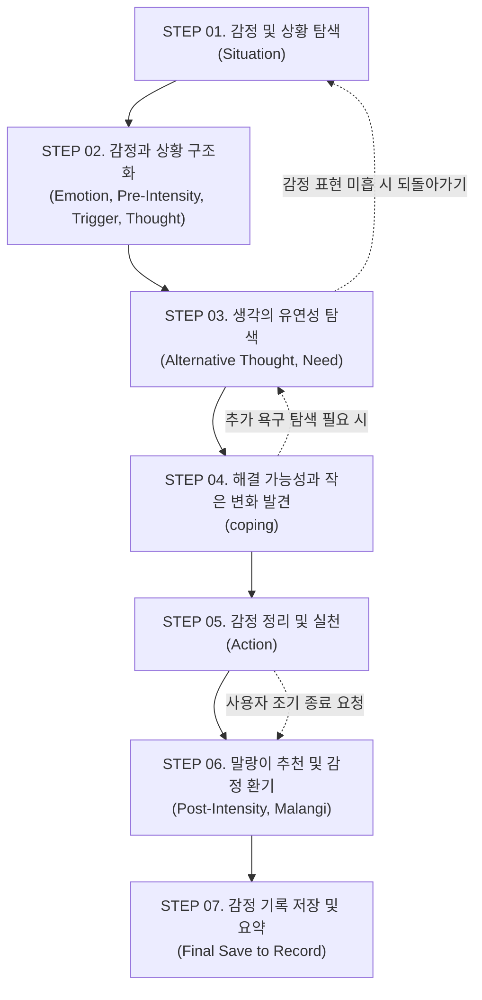

# 7단계 AI 감정 상담 프로세스 명세 (Dialogue Process)

[감정 대화 시스템 README](README.md) · [위기 대응 규칙](safety.md) · [대화 제어 아키텍처](design.md) · [데이터베이스 설계](../database.md)

AI 감정 상담의 7개 단계(STEP 01 ~ STEP 07)에 대한 상세 요구사항, 수집 데이터 규약, 핵심 발화 및 단계 전이 규칙을 정의합니다.

---

## 1. 전체 프로세스 흐름도

---

## 2. 단계별 상세 명세

### STEP 01. 감정 및 상황 탐색 (Situation)

- **목적:** 사용자가 자신의 고민과 상황을 부담 없이 편안하게 표현하도록 유도
- **상담 기법:** 공감적 경청, 개방형 질문
- **수집 데이터:**
  - `situation` (문자열): 사용자가 겪은 구체적인 사건, 시점, 주변 환경 및 핵심 어려움
- **시스템 지침:**
  - 사용자의 발화를 평가하거나 해결하려 들지 않고, 온전히 경청하고 수용합니다.
  - "왜 그랬어요?" 같은 추궁형 어조를 지양하고 "무슨 일이 있었나요?", "어떤 상황이었나요?"의 표현을 사용합니다.
- **핵심 질문 예시:**
  > “그 상황에서 마음이 불편했던 일이 있었나요?”
  > “그 일이 있고 나서 계속 생각나는 장면이나 순간이 있나요?”
- **다음 단계 전이 조건:** 사용자가 경험한 사건과 현재 겪고 있는 핵심 고민의 윤곽이 드러났을 때

---

### STEP 02. 감정과 상황 구조화 (CBT)

- **목적:** 상황 속에서 발생한 감정을 명확히 분리·인식하고, 상담 전 기준 상태를 수치화하여 기록
- **상담 기법:** 인지행동치료(CBT) 감정 인식 및 척도 질문
- **수집 데이터:**
  - `primary_emotion` (문자열): 핵심 대표 감정 1개 (예: 속상함, 불안, 분노, 슬픔, 억울함 등)
  - `secondary_emotion` (문자열, 선택): 부가 감정 1개 (예: 답답함, 외로움 등)
  - `pre_intensity` (정수, 0~10): 상담 전 현재 감정의 주관적 강도
  - `trigger_factor` (문자열): 감정을 폭발시키거나 자극한 직접적인 계기
  - `initial_thought` (문자열): 그 순간 떠오른 최초의 자동적 사고
- **시스템 지침:**
  - **감정 강도(`pre_intensity`)는 AI가 임의로 추정하지 않고 사용자가 직접 0~10 사이의 점수를 입력하도록 합니다.**
  - 상황(Fact)과 생각(Thought), 감정(Emotion)을 명확하게 분리할 수 있도록 돕습니다.
- **핵심 질문 예시:**
  > “그 상황에서 가장 크게 느껴지는 감정은 무엇인가요? (예: 서운함, 억울함, 불안 등)”
  > “지금 그 감정의 크기를 0점부터 10점까지 점수로 표현한다면 몇 점 정도일까요?”
  > “그 감정이 올라오던 순간 머릿속에 가장 먼저 스친 생각은 무엇이었나요?”
- **다음 단계 전이 조건:** 대표 감정, 사전 강도, 최초 생각이 구조화되었을 때

---

### STEP 03. 생각의 유연성 탐색 (소크라테스식 대화법 & NVC)

- **목적:** 감정을 유발한 자동적 사고의 타당성을 부드럽게 점검하고, 그 생각 이면에 감추어진 진정한 내면 욕구를 발견
- **상담 기법:** 소크라테스식 산파술(근거 및 반례 탐색), 비폭력대화(NVC 욕구 파악)
- **수집 데이터:**
  - `alternative_thought` (문자열): 사건을 바라보는 새로운 대안적 관점이나 해석
  - `underlying_need` (문자열): 사용자가 당시 진정으로 바랐던 핵심 욕구 (인정, 존중, 휴식, 안전 등)
- **시스템 지침:**
  - 사용자의 기존 생각을 "잘못되었다", "비합리적이다"라고 비판하거나 논박하지 않습니다.
  - "반대로 생각해보면 어떨까요?", "다른 가능성은 없을까요?"처럼 사용자가 스스로 다른 시각을 탐색하도록 안내합니다.
  - 감정 아래에 깔린 인간적인 욕구를 긍정적으로 확인해 줍니다.
- **핵심 질문 예시:**
  > “그렇게 생각하게 된 데에는 어떤 이유나 근거가 있었나요?”
  > “혹시 상대방의 다른 사정이나, 내가 생각하지 못했던 다른 가능성이 있을 수도 있을까요?”
  > “그 상황에서 사실 가장 간절하게 바랐던 것은 무엇이었나요?”
- **다음 단계 전이 조건:** 사용자가 기존 생각 외의 대안적 관점을 최소 1가지 떠올리고, 자신이 원했던 욕구를 인식했을 때

---

### STEP 04. 해결 가능성과 작은 변화 발견 (SFBT)

- **목적:** 사용자가 이미 가지고 있는 내면의 힘, 대처 자원과 예외 상황을 일깨움
- **상담 기법:** 해결중심 단기치료(SFBT) 예외 질문, 대처 질문
- **수집 데이터:**
  - `coping_strategy` (문자열): 과거에 비슷한 상황을 버텨왔거나 도움이 되었던 방법
- **시스템 지침:**
  - 사용자가 무기력함을 느끼지 않도록 이미 지금까지 잘 버텨온 자원을 찾아내어 인정합니다.
  - "문제가 조금 덜했던 순간"이나 "조금이라도 안정이 되었던 순간"에 초점을 맞춥니다.
- **핵심 질문 예시:**
  > “이런 힘든 상황에서도 지금까지 어떻게 버텨올 수 있었나요?”
  > “이전에도 비슷한 힘듦이 있었을 때, 조금이라도 마음에 도움이 되었던 방법이 있었나요?”
  > “문제가 조금 덜 느껴졌던 순간이 있었다면 언제였나요?”
- **다음 단계 전이 조건:** 과거의 대처 경험이나 긍정적 자원이 최소 1가지 언급되었을 때

---

### STEP 05. 감정 정리 및 실천 (CBT + SFBT)

- **목적:** 정리된 새로운 생각과 자원을 바탕으로, 일상에서 즉시 실천해볼 수 있는 아주 작은 행동을 스스로 선택
- **상담 기법:** 인지 재구성 마무리 및 행동 활성화
- **수집 데이터:**
  - `action_plan` (문자열): 사용자가 직접 선택한 현실적인 작은 실천 행동
- **시스템 지침:**
  - 거창하거나 부담스러운 목표가 아니라 "오늘 당장 5분 동안 할 수 있는 작은 행동"을 찾도록 유도합니다.
  - AI가 행동을 지시하지 않고, 사용자가 직접 선택할 수 있는 후보들을 제안하거나 직접 말하도록 합니다.
  - 만약 지금 당장 어떤 행동도 할 에너지가 없다면 "충분한 휴식 취하기"도 훌륭한 실천 행동으로 수용합니다.
- **핵심 질문 예시:**
  > “처음 생각과 비교했을 때, 지금 상황을 바라보는 마음에 달라진 부분이 있나요?”
  > “마음이 한결 편안해지기 위해, 오늘 당장 스스로에게 해줄 수 있는 아주 작은 행동은 무엇이 있을까요?”
- **다음 단계 전이 조건:** 사용자가 실천할 작은 행동 1가지를 명확히 정했을 때

---

### STEP 06. 말랑이 추천 및 감정 환기

- **목적:** 상담 전체 내용을 간결히 요약하고, 상담 후 감정 강도를 재측정하며, 감정 상태에 맞는 말랑이 캐릭터와 촉각적 환기를 연결
- **상담 기법:** 상담 종결 및 감각적 접지(Grounding)
- **수집 데이터:**
  - `post_intensity` (정수, 0~10): 상담 후 현재 감정 강도 (사용자 직접 입력)
  - `recommended_malangi` (문자열): 추천 말랑이 유형 (`SLANGI`, `SQUISHY`, `WAKPPU`)
  - `summary` (문자열): AI가 작성한 이번 상담의 1~2줄 핵심 요약
- **말랑이 추천 규칙:**
  - **슬랑이 (SLANGI):** 주 감정이 '불안', '우울', '초조'일 때 ➔ 천천히 만지며 긴장 완화
  - **스퀴시 (SQUISHY):** 주 감정이 '속상함', '슬픔', '외로움'일 때 ➔ 부드럽게 감싸 쥐며 위로
  - **왁뿌볼 (WAKPPU):** 주 감정이 '분노', '스트레스', '억울함'일 때 ➔ 강하게 누르고 깨뜨리며 감정 분출
- **시스템 지침:**
  - 사전 강도(`pre_intensity`)와 사후 강도(`post_intensity`)의 차이를 산출하되, 강도가 낮아지지 않았다고 해서 실패로 규정하지 않습니다.
- **핵심 안내 예시:**
  > “지금 마음의 무게는 0~10점 중 몇 점 정도로 느껴지시나요?”
  > “오늘 나눈 대화를 바탕으로, 속상한 마음을 부드럽게 감싸줄 [스퀴시]를 추천해 드려요. 말랑이를 만지며 남은 감정을 편안하게 환기해 보세요.”
- **다음 단계 전이 조건:** 사후 감정 강도가 입력되고 말랑이 추천 카드가 사용자에게 전달되었을 때

---

### STEP 07. 감정 기록 저장 및 요약 (Final Save)

- **목적:** 세션의 구조화된 데이터 전체를 영구 기록(`EmotionRecord`)으로 저장하고 '마음 기록함'에서 열람할 수 있도록 확정
- **수집 및 저장 데이터:**
  - `EmotionRecord` 테이블의 모든 필드 확정 (`status = 'COMPLETED'`)
  - 대화 턴 전체를 `CounselingMessage`로 연결 보관
- **시스템 지침:**
  - 사용자가 확인한 최종 내용만을 저장하며, AI가 추정한 미확인 데이터는 저장하지 않습니다.

---

## 3. 대화 운영 및 유연한 전이 원칙

1. **질문은 한 번에 하나씩:** 한 번의 턴에서 여러 개의 질문을 쏟아내지 않고 가장 핵심적인 단일 질문만 던집니다.
2. **공감 우선의 원칙:** 다음 질문으로 넘어가기 전에 사용자가 방금 털어놓은 감정에 대해 충분한 공감과 반영(Reflection)을 선행합니다.
3. **사용자의 속도 존중:**
   - 사용자가 "그냥 들어줘", "잘 모르겠어"라고 답변하면 질문을 밀어붙이지 않고 감정 반영 상태에 머무릅니다.
   - 사용자가 "그만할래"라고 요청하면 즉시 STEP 06으로 이동하여 감정을 갈무리하고 종료합니다.
4. **되돌아가기 허용:** STEP 03이나 04를 진행하다가도 사용자가 새로운 핵심 사건이나 강한 감정을 표현하면 언제든 이전 단계로 돌아가 다시 구조화합니다.
