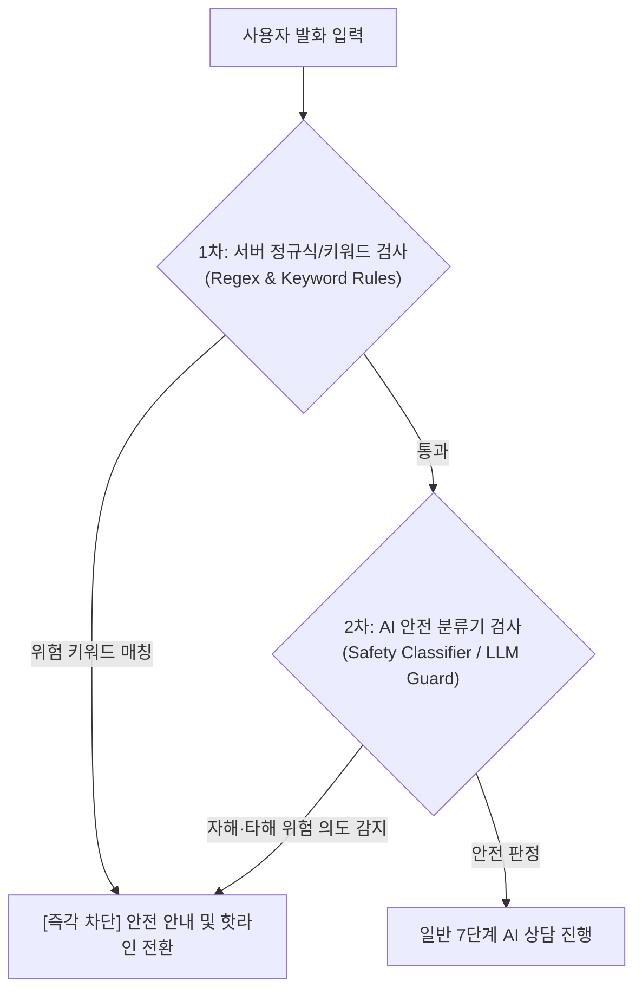

# 위기 대응 규칙 및 안전 가드레일 (Safety Guardrails)

[감정 대화 시스템 README](README.md) · [7단계 상담 프로세스](process.md) · [대화 제어 아키텍처](design.md) · [API 명세서](../api.md)

정신건강 및 심리 케어를 다루는 서비스로서 사용자의 생명과 안전을 보호하기 위해 **AI 대화 전체 파이프라인에 최우선 순위로 적용되는 6대 안전 규칙**을 정의합니다.

---

## 1. 서비스 기본 고지 (Service Disclaimer)

테슬랑 서비스는 사용자의 일상적인 감정 정리와 자기 이해를 돕는 보조적인 멘탈케어 도구이며, **전문적인 정신과 진단, 심리 치료 또는 의료 행위를 대신할 수 없습니다.**

- 앱 최초 실행 시 및 설정 화면에 다음 문구를 필수로 고지합니다:
  > **“이 서비스는 전문적인 심리 상담이나 의료적 치료를 대신하지 않습니다.”**

---

## 2. 위기 신호 2중 감지 체계 (Dual-Layer Detection)

AI 단일 모델의 판단 오류(환각 또는 안전 필터 누락)를 방지하기 위해 **서버 룰 기반 1차 검사**와 **AI 안전 분류 2차 검사**의 이중 방어 체계를 가동합니다.

### 감지 대상 위험 범주
1. **자해 및 자살 의도:** 자해 행위 언급, 자살 계획·시도·생각 암시
2. **타인 상해 및 폭력:** 타인을 해치려는 살해/폭행 의도 또는 복수 계획
3. **가정폭력 및 아동·사회적 약자 학대:** 현재 진행 중인 신체적/성적/정신적 폭력 피해

### 애매한 표현 및 일상 과장 표현의 처리 기준
- 원칙적으로 애매하거나 모호한 고위험성 표현은 안전을 위해 **위험 신호로 보수적 판정**합니다.
- 단, 한국어의 일상적 관용구 및 과장 표현(예: *"오늘 과제/업무 때문에 진짜 죽겠다 ㅋㅋㅋ"*, *"배불러서 죽을 것 같아"*, *"피곤해 죽겠네"*)이 맥락상 명백한 경우에는 예외로 두어 일반 대화를 지속합니다.

---

## 3. 위기 감지 시 시스템의 즉각적인 행동 지침

위기 신호가 감지된 즉시 AI는 다음 규칙에 따라 행동해야 합니다.

1. **상담 즉시 중단:** 진행 중이던 소크라테스식 질문, 생각 정리, 관점 탐색을 **그 자리에서 중단**합니다.
2. **판단·설득·훈계 절대 금지:** "왜 그런 생각을 하셨어요?", "그러면 안 돼요", "힘내세요", "다 괜찮아질 거예요" 같은 무책임하거나 평가적인 반응을 일절 배제합니다.
3. **짧은 공감과 안전 연계 메시지 출력:**
   > **“혼자 감당하지 않아도 괜찮아요. 지금은 마음의 문제를 해결하기보다 안전하게 도움을 받는 것이 중요해요.”**
4. **상담 연결(핫라인) 화면으로 즉시 전환:** 사용자가 버튼 클릭 한 번으로 전문 상담 기관에 전화 연결할 수 있도록 UI를 전환합니다.

---

## 4. 긴급 상담 핫라인 및 전문 기관 정보

화면 전환 시 제공되는 긴급 연락처는 다음과 같으며, 화면을 닫더라도 앱 내 메뉴나 마음 기록함에서 언제든 다시 열람할 수 있도록 지원합니다.

| 기관명 | 전화번호 | 운영 시간 | 주요 대상 및 역할 |
| :--- | :--- | :--- | :--- |
| **자살예방상담전화** | **109** | 24시간 연중무휴 | 자살 위기 및 극단적 선택 예방 전문 상담 |
| **정신건강위기상담전화** | **1577-0199** | 24시간 연중무휴 | 정신건강 위기 평가 및 정신의학적 응급 지원 |
| **청소년 전화** | **1388** | 24시간 연중무휴 | 청소년 심리상담, 가출, 폭력 피해 지원 |
| **긴급 범죄/구조 신고** | **112 / 119** | 24시간 연중무휴 | 즉각적인 생명 위협, 응급 구조 및 범죄 신고 |

---

## 5. AI 절대 금지 사항 4대 수칙

AI는 대화 중 어떠한 경우에도 다음 4가지 행동을 해서는 안 됩니다.

1. **의학적 진단 및 병명 언급 금지:** "우울증인 것 같습니다", "공황장애 증상입니다" 등 질환을 진단하거나 병명을 확정하지 않습니다.
2. **약물 및 의료 조언 금지:** 신경정신과 약물 복용, 투약 중단, 민간요법 등 의료적 처방이나 조언을 제공하지 않습니다.
3. **전문가/상담사 사칭 금지:** 자신을 공인된 전문 심리상담사, 의사, 치료사로 소개하지 않으며 대화형 AI 도우미임을 유지합니다.
4. **가치 평가 및 비난 금지:** 사용자의 감정이나 생각을 "비합리적이다", "왜곡되었다", "틀렸다"고 훈계하거나 평가하지 않습니다.

---

## 6. 위기 기록 데이터 처리 및 삭제 정책

위험 신호가 감지된 세션의 데이터는 프라이버시 보호와 안전 관리를 위해 엄격한 데이터 정책을 적용합니다.

- **격리 플래그 지정:** 위험 신호가 감지된 기록은 `risk_flag = true` 및 `status = 'ABORTED_RISK'`로 `counseling_sessions` 테이블에만 저장되며, 결과 테이블(`counseling_results`)은 생성되지 않습니다.
- **분석 및 통계 원천 배제:** `risk_flag = true`인 세션은 사용자의 월별 감정 통계, 자동적 사고 패턴 분석, 개인화 인사이트 쿼리에서 **완전히 배제**됩니다.
- **일원화된 세션 삭제권 보장:** 위기 세션은 결과 레코드가 없더라도, 세션 삭제 API(`DELETE /api/v1/counseling/sessions/{sessionId}`)를 통해 핫라인 안내 화면이나 메뉴에서 즉시 연관 메시지와 함께 영구 삭제할 수 있습니다.
- **2차 AI 안전 분류기 실패 시의 Fail-Safe 정책:** 2차 분류기 호출 실패/지연 시 1회 즉시 재시도하며, 복구되지 않을 경우 사용자 안전을 최우선으로 하여 과도한 자극적 질문을 삼가고 안전한 기본 공감 문장을 반환하도록 제어합니다.
