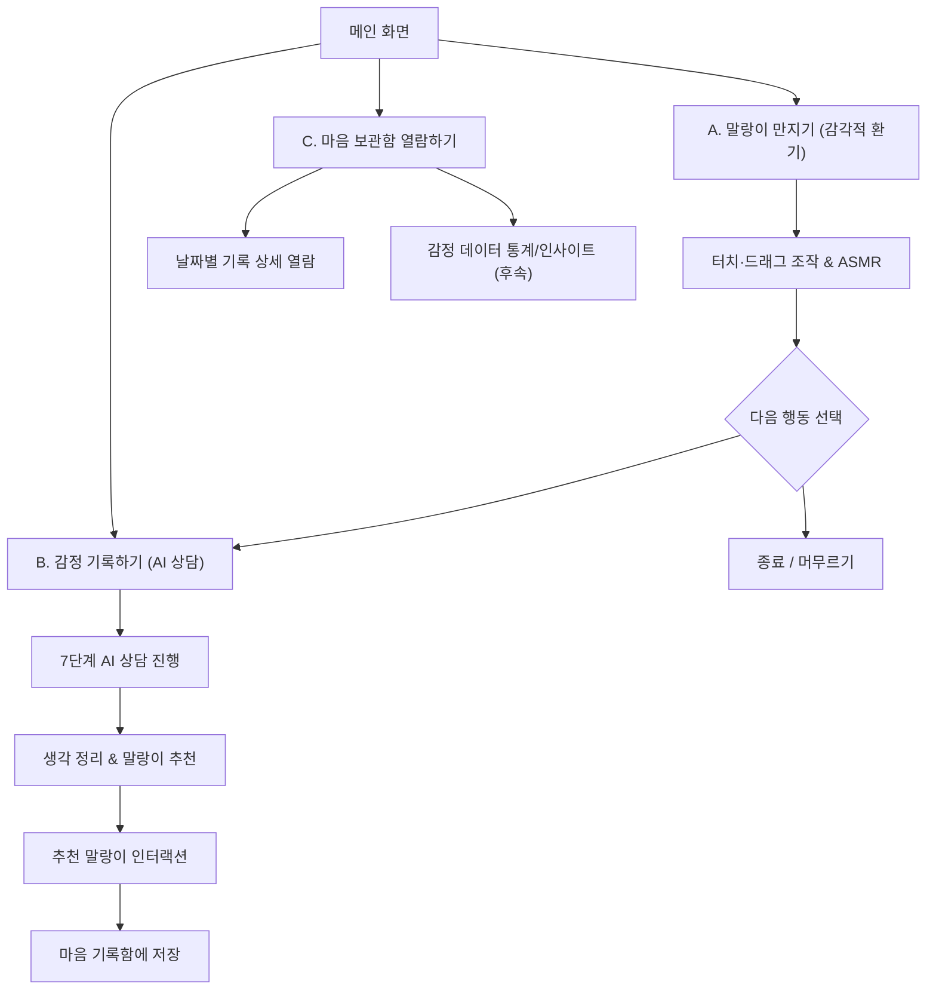
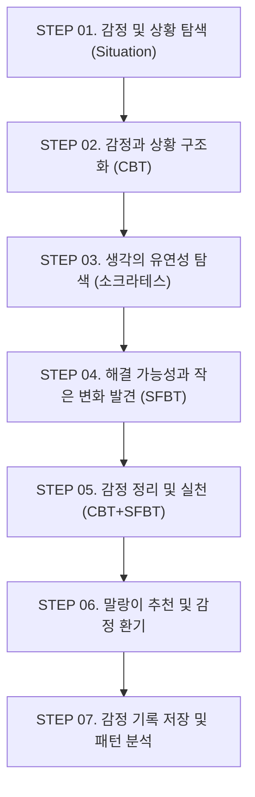

# 서비스 기획안: 테슬랑

[README로 돌아가기](../README.md) · [AI 감정 대화 시스템](../emotional-dialogue/README.md) · [기능 명세서](features.md) · [API 명세서](api.md) · [데이터베이스 설계](database.md)

사용자가 제공한 PM 확정 기획서(서비스명: **테슬랑**)를 바탕으로 정리한 제품 기획 문서입니다.
현재 백엔드는 기본 실행 기반(Spring Boot 4, MySQL, Hexagonal Architecture, Health API)이 구축되어 있으며, 업무 기능은 본 기획안에 정의된 MVP 범위를 기준으로 설계를 구체화하고 구현을 진행합니다.

---

## 1. 서비스 개요

- **서비스명:** **테슬랑** (Teslang)
- **한 줄 소개:** *“AI와 함께 감정을 정리하고, 나만의 감정 패턴을 발견하여 더 나은 방향으로 나아갈 수 있도록 돕는 개인화 감정 케어 서비스”*
- **핵심 키워드:** AI 감정 대화 · 생각 정리 · 감정 기록 · 개인화 · 감정 패턴 분석 · 말랑이 인터랙션

### 서비스 방향

사용자가 자신의 고민과 감정을 텍스트 또는 음성으로 기록하면, AI가 제공하는 질문과 대화를 통해 감정의 원인과 사고 과정을 구체화하고, 이후 축적된 감정 기록들을 분석하여 개인에게 맞는 감정 케어 방향을 제공하는 **AI 기반 장기형 감정 케어 서비스**입니다.

기존 AI 서비스가 사용자의 고민에 즉각적으로 공감만 하고 조언을 준 뒤 대화가 종료되는 **일회성 상담 구조**에 집중했다면, 테슬랑은 한 번의 대화에 그치지 않고 사용자의 감정 기록을 지속적으로 축적하여 **시간에 따른 감정 변화와 반복적인 감정 패턴을 분석**합니다.

또한 AI 상담 이후 사용자의 감정 상태에 적합한 ‘말랑이’를 추천하고, 사용자가 직접 터치·드래그하며 말랑이 형태를 변형시키는 인터랙션과 상황에 맞는 ASMR 사운드를 재생함으로써 **인지적인 감정 정리와 감각적인 감정 환기를 하나의 경험**으로 연결합니다.

---

## 2. 서비스 배경 및 문제 정의

### 핵심 문제

> **“사용자는 자신의 감정을 충분히 이해하지 못한 채 감정을 소비하고 있으며, 한 번의 상담만으로는 반복되는 감정 문제를 해결하기 어렵습니다.”**

1. **현대인의 감정 억압과 멘탈 번아웃**
   - 현대 2030 청년층은 SNS 속 완벽한 모습과 직장·학교 내 관계 유지 압박으로 인해 부정적 감정(분노, 불안, 우울, 억울함)을 솔직하게 분출하지 못하고 가면을 쓴 채 버팁니다.
2. **기존 텍스트 중심 멘탈케어 서비스의 한계**
   - 기존 감정 일기 앱이나 심리 상담 서비스는 긴 텍스트 작성을 요구하여 피로도가 높습니다.
   - 감정을 기록한 뒤에도 즉각적인 신체적·감각적 해소감(카타르시스)을 주지 못해 리텐션이 급감합니다.

| 문제 | 내용 |
| :--- | :--- |
| **감정을 정확히 파악하기 어려움** | 단순히 ‘힘들다’, ‘짜증난다’ 정도로만 감정을 인식하고 왜 그런지 깊게 생각하지 못함 |
| **감정 기록의 한계** | 기록은 남지만 그 안에서 반복되는 패턴과 취약점을 발견하기 어려움 |
| **AI 상담의 한계** | 일회성 공감이나 일반적인 조언에 그치는 경우가 많음 |
| **감정 관리의 지속성 부족** | 상담이 끝나면 이후의 감정 변화가 다음 경험으로 연결되지 않음 |
| **해결과 행동의 간극** | 감정을 이해해도 실제로 무엇을 해야 할지 모호함 |

---

## 3. 서비스 목표 및 핵심 컨셉

### 핵심 컨셉

> **“나를 대신해 해결해주는 서비스가 아니라, 나의 감정을 이해하도록 돕는 서비스”**

- 서비스의 핵심은 AI의 일방적인 조언이나 해결 방안 제시가 아니라, **질문과 답변을 통해 감정을 명확히 이해하고 수용하는 과정**에 있습니다.
- AI가 사용자의 감정을 임의로 판단하고 해결해주는 것이 아니라, 적절한 질문을 던져 사용자가 자신의 감정을 직접 꺼내고 문답을 통해 생각을 확장하며 상황을 새로운 관점에서 바라볼 수 있도록 돕습니다.
- 기록된 감정 데이터를 지속적으로 저장하고 분석하여 사용자가 스스로 발견하기 어려운 **개인의 감정 패턴과 취약점, 반복적인 스트레스 요인**을 찾아 제공합니다.
- 개인의 패턴을 바탕으로 심리적으로 건강한 상태를 유지할 수 있도록 **맞춤형 조언과 공감**을 제시하며 **지속적인 감정 케어**를 제공합니다.

---

## 4. 주요 타겟 및 페르소나

### 타겟 사용자

자신의 감정을 혼자 정리하기 어려우며 전문적인 상담에는 부담을 느끼는 **10~30대 사용자**

- 학업 및 취업 스트레스가 많은 학생·취준생
- 인간관계에서 감정 소모가 많은 사용자
- 자신의 감정을 글로 정리하기 어려운 사용자
- 전문적인 상담보다 가볍게 자신의 감정을 관리하고 싶은 사용자

| 사용자 유형 | 주요 상황 | 주요 니즈 |
| :--- | :--- | :--- |
| **대학생** | 과제, 시험, 팀플 | 학업 스트레스 정리 |
| **사회 초년생** | 업무, 직장 인간관계 | 감정 소모 관리 |
| **취준생** | 취업, 미래에 대한 불안 | 불안 및 생각 정리 |
| **인간관계 고민 사용자** | 친구, 연애, 가족 | 관계에서 발생하는 감정 정리 |

**핵심 니즈:** *“누군가에게 털어놓고 싶지만 부담스럽고, 혼자 생각하면 생각이 꼬여버린다.”*

---

## 5. 서비스 전체 구조 및 핵심 진입 경로

테슬랑은 AI 상담부터 시작하는 경로뿐만 아니라, 말랑이를 먼저 만지며 감정을 환기하는 경로를 함께 제공하여 사용자의 자율성을 존중합니다.

### 진입 흐름 3가지

1. **A. 말랑이 먼저 만지기 (감정 환기 우선 경로):**
   - 메인 화면 → 말랑이 터치 → 말랑이 만지기 → 계속 이용 / 감정 정리하기 / 이용 종료
   - *목적:* 당장 고민을 설명하기 어렵거나 우선 편안하게 감정을 환기하고 싶은 사용자에게 적합 (감정 선택이나 AI 상담을 강제하지 않음)
2. **B. 감정 먼저 기록하기 (감정 정리 우선 경로):**
   - 메인 화면 → 감정 기록하기 → AI 상담 → 상담 결과 정리 → 말랑이 추천 → 말랑이 이용 → 기록 저장
   - *목적:* 자신의 감정과 생각을 언어로 정리하고 싶은 사용자에게 적합
3. **C. 마음 보관함 열람하기:**
   - 메인 화면 우측 하단 메뉴 → 마음 보관함(마음 기록함) → 과거 감정 기록 및 상담 요약 열람

---

## 6. 메인 화면 및 말랑이 인터랙션

### 메인 화면 구성

- **기능 목적:** 서비스의 핵심 진입점 제공
- **주요 UI:** 중앙 기본 말랑이 캐릭터, 우측 하단 상세 메뉴(원형 메뉴) 버튼, '감정 기록하기' 버튼
- **핵심 원칙:** 메인 화면에서는 사용자가 말랑이를 만지며 지금 감정을 환기할 것인지, 감정 기록을 통해 생각을 정리할 것인지를 자유롭게 선택하도록 보장합니다. 복잡한 메뉴는 우측 하단 버튼에 배치하여 집중도를 높입니다.

### 말랑이 인터랙션 (F-05)

말랑이는 단순한 3D 모델이 아닌 **감정 환기를 위한 인터랙션 도구**입니다. 사용자의 터치와 드래그에 따라 형태가 변형되고, 이에 맞춰 촉각적인 느낌을 전달하는 ASMR 사운드를 제공합니다.

| 종류 | 주요 대응 감정 | 인터랙션 특징 및 조작 |
| :--- | :--- | :--- |
| **슬랑이** | 불안 / 우울 | 천천히 만지기. Tap(눌림), Long Press(압축), Drag(늘어남), Release(3초 미조작 시 5초에 걸쳐 복원) |
| **스퀴시** | 속상함 / 슬픔 | 부드럽게 누르기. Drag 시 슬랑이보다 변형 작음, Release(3초 미조작 시 3초에 걸쳐 복원) |
| **왁뿌볼** | 분노 / 스트레스 | 강하게 누르기. 왁스가 깨진 후 스퀴시 조작으로 연결 (Tap/반복 터치 시 왁스 파쇄 효과) |
| **커스텀** | 사용자 선택 | 사진 업로드 기반 외형 커스텀 (개발 우선순위에서 제외되어 MVP 미포함) |

### 원형 메뉴 및 수면 모드 (F-06, F-10)

- **원형 메뉴:** 말랑이 인터랙션 화면을 벗어나지 않고도 `감정 기록하기(AI 상담)`, `수면 모드`, `마음 보관함`에 원클릭으로 접근
- **수면 모드:** 백색소음, 빗소리, 자연음, 수면 유도 음악을 재생하며 말랑이가 무드등 시각 효과를 내며 느리게 움직임. 타이머 설정 후 자동 종료 (MVP 후순위 기능으로 분류)

---

## 7. AI 감정 대화 시스템

> 상세한 7단계 프로세스 명세와 위기 대응 가드레일은 독립 전문 문서인 **[AI 감정 대화 시스템](../emotional-dialogue/README.md)** ([7단계 프로세스](../emotional-dialogue/process.md) · [위기 대응 규칙](../emotional-dialogue/safety.md))에서 관리합니다.

AI 상담 시스템은 **인지행동치료(CBT), 소크라테스식 대화법, 해결중심 단기치료(SFBT), 비폭력대화(NVC)**의 원리를 결합한 대화형 감정 케어 기능입니다.

### 4대 통합 심리 상담 기법

| 적용 기법 | 주요 역할 | 서비스 적용 내용 |
| :--- | :--- | :--- |
| **CBT (인지행동치료)** | 생각·감정·행동의 관계 파악 | 자동적 사고 및 감정 유발 요인 분석, 생각의 재구성 |
| **소크라테스식 대화법** | 스스로 생각을 검토하도록 유도 | 근거·반례·대안적 관점 탐색 질문 |
| **SFBT (해결중심 단기치료)** | 강점 및 해결 가능성 발견 | 예외 상황, 과거 대처 능력, 실천 가능한 작은 변화 탐색 |
| **NVC (비폭력 대화)** | 감정 뒤에 있는 욕구 파악 | 사용자가 사건 상황에서 실제로 바랐던 핵심 욕구 탐색 |

### 7단계 AI 상담 프로세스

| 단계 | 목적 | 주요 데이터 및 처리 내용 | 핵심 질문 예시 |
| :--- | :--- | :--- | :--- |
| **STEP 01 감정 및 상황 탐색** | 사건·상황의 부담 없는 표현 유도 | `Situation`: 사건, 당시 환경, 핵심 고민 확인 | “그 상황에서 마음이 불편했던 일이 있었나요?”, “그 일이 있고 나서 계속 생각나는 장면이 있나요?” |
| **STEP 02 감정과 상황 구조화** | 감정 명확화 및 상담 전 상태 기록 | `Emotion`: 대표 감정 1개 + 부가 감정 1개 `Intensity`: 대화 전 감정 강도 (0~10점 사용자 직접 입력) `Trigger`: 감정 유발 요소 `Thought`: 자동적 사고 분리 | 감정 강도는 AI가 추측하지 않고 사용자가 직접 입력 |
| **STEP 03 생각의 유연성 탐색** | 자동적 사고 검토 및 내면 욕구 파악 | `Thought`: 초기 자동적 사고 `Alternative Thought`: 대안적 관점/해석 `Need`: 감정 뒤 실제 원했던 욕구 | “그 상황에서 가장 먼저 떠오른 생각은 무엇이었나요?”, “그렇게 생각하게 된 이유는 무엇인가요?”, “그때 사실 가장 바랐던 건 무엇이었나요?” |
| **STEP 04 해결 가능성 발견** | 기존 대처 자원과 강점 탐색 | `coping`: 과거 버텨온 방식, 예외 상황, 도움이 된 행동 | “이런 상황에서도 지금까지 어떻게 버텨 왔나요?”, “문제가 조금 덜했던 순간은 언제였나요?” |
| **STEP 05 감정 정리 및 실천** | 새로운 관점 확장 및 현실적 행동 선택 | `Action`: 사용자가 수용 가능한 실천 행동 1가지 | “처음에는 어떻게 생각했는데, 지금은 달라진 부분이 있나요?”, “그렇게 되기 위해 지금 할 수 있는 작은 행동은 무엇이 있을까요?” |
| **STEP 06 말랑이 추천 및 환기** | 상담 요약 및 전후 감정 변화 확인 | `post_intensity`: 대화 후 감정 강도 (0~10점 재입력) 상담 요약 및 상태 맞춤형 말랑이 추천 | 상담 전후 감정 강도 차이 기록, 감정에 적합한 말랑이(슬랑이/스퀴시/왁뿌볼) 추천 |
| **STEP 07 기록 저장 및 분석** | 상담 데이터 축적 및 장기 패턴화 | 날짜별 구조화 데이터 저장, 위험 신호 없는 정상 기록 아카이빙 | 마음 기록함에 구조화된 데이터 저장 |

---

## 8. 위험 대응 규칙 (Safety Guardrails)

정신건강을 다루는 서비스로서 AI 대화 전체에 엄격한 안전 원칙을 적용합니다.

### 1. 위험 신호 감지
- **이중 검사 체계:** 1차 서버 정규식/키워드 규칙 검사 ➔ 2차 AI 안전 분류 모델 검사 (AI 판단 단독에 의존하지 않음).
- **감지 대상:** 자해·자살 생각, 타인 상해/공격성, 학대·폭력 피해 등.
- 애매한 표현은 위험 신호로 처리하되, "과제 때문에 죽겠다 ㅋㅋ"와 같이 과장된 일상 표현이 명백한 경우에만 예외를 둡니다.

### 2. 감지 시 시스템 행동
- 진행 중이던 질문, 생각 정리, 관점 탐색을 **즉시 중단**합니다.
- 사용자의 고통을 짧게 공감하고 혼자 견디지 않아도 됨을 알린 후 **상담 연결 화면으로 즉시 전환**합니다.
  - *예시 문구:* “혼자 감당하지 않아도 괜찮아요. 지금은 마음의 문제를 해결하기보다 안전하게 도움을 받는 것이 중요해요.”
- 해결책 제시, 설득, 훈계, "괜찮아질 거예요" 같은 무책임한 위로는 절대 하지 않습니다.

### 3. 긴급 상담 핫라인 연결
- **자살예방상담전화:** 109 (24시간)
- **정신건강위기상담전화:** 1577-0199 (24시간)
- **청소년 상담:** 1388
- **긴급 신고:** 112 / 119
- 연결 화면을 닫아도 보관함이나 메뉴에서 언제든 다시 볼 수 있도록 제공합니다.

### 4. AI 절대 금지 사항
- 의학적 진단을 내리거나 병명을 언급하지 않습니다.
- 약물 복용이나 치료 방법 등 의료적인 조언을 하지 않습니다.
- 스스로를 상담사나 전문 의료인으로 소개하지 않습니다.
- 사용자의 생각을 "잘못됐다", "비합리적이다"라고 비난·평가하지 않습니다.

### 5. 서비스 고지 및 데이터 처리
- 첫 시작 시 및 설정 화면에 **"이 서비스는 전문 상담이나 치료를 대신하지 않습니다"**를 명시합니다.
- 위험 신호가 감지된 대화는 `risk_flag = true`로 표시하여 저장합니다.
- `risk_flag` 기록은 **개인화 패턴 분석이나 통계에서 완전히 배제**됩니다.
- 사용자가 삭제를 요청하면 일반 기록과 동일하게 영구 삭제됩니다.

---

## 9. 마음 기록함 및 데이터 분석

상담이 종료되면 구조화된 데이터를 기반으로 날짜별 감정 기록을 생성합니다.

### 날짜별 감정 기록 항목
- 상담 일시
- 대표 감정 및 부가 감정
- 대화 전·후 감정 강도 (0~10)
- 기존 생각(Thought)과 대안적 생각(Alternative Thought)
- 사용자가 선택한 대처 방법(coping) 및 실천 행동(Action)
- 추천받은 말랑이 유형
- AI 상담 요약

### 장기 분석 및 개인화 인사이트 (MVP 후순위)
- **월별 감정 변화 분석:** 한 달간 자주 나타난 감정, 전후 강도 변화, 상황별 반복 감정, 사고 패턴 유형.
- **개인화 인사이트:** 누적 기록 기반 감정 및 사고 경향 피드백 (충분한 데이터가 쌓인 이후 제공하며 대화 전후 점수 변화만으로 임상적 효과를 단정하지 않음).

---

## 10. 핵심 서비스 루프

### 서비스 루프 정의

**감정 표현 → AI 감정 정리 → 말랑이 상호작용 → 기록 축적 → 자기 이해 → 재방문**

| 단계 | 사용자 행동 | 서비스 반응 | 생성 데이터 |
| :--- | :--- | :--- | :--- |
| **① 감정 표현** | 고민과 현재 감정 입력 | 상황 및 감정 기록 시작 | `Emotion_Record` (초안) |
| **② AI 감정 정리** | AI 질문에 답변 | 생각·감정·욕구 탐색 | `Conversation_Message` |
| **③ 새로운 관점 발견** | 자신의 생각을 돌아봄 | 대안적 생각과 행동 정리 | `Counseling_Result` |
| **④ 감정 변화 확인** | 상담 후 감정 강도 입력 | 전후 감정 상태 비교 | `Emotion_Record` (갱신) |
| **⑤ 말랑이 추천 및 이용** | 추천된 말랑이 만지기 | 캐릭터 반응 및 ASMR 제공 | `Malangi_Usage` |
| **⑥ 기록 축적** | 상담 종료 및 저장 | 날짜별 기록 관리 | `Emotion_Record` (확정) |
| **⑦ 자기 이해** | 과거 기록 확인 | 감정 변화 및 반복 패턴 확인 | 누적 기록 분석 (후속) |
| **⑧ 재방문** | 새로운 감정 발생 시 재이용 | 이전 기록을 참고한 개인화 경험 | 신규 `Emotion_Record` |

---

## 11. MVP 범위 정의

### MVP 개발 목표 (3가지)

1. 사용자가 AI와의 대화를 통해 자신의 감정과 생각을 명확히 정리할 수 있는가?
2. 말랑이를 만지는 상호작용이 감정 환기 경험에 실질적으로 도움이 되는가?
3. 상담 전후의 감정 변화를 신뢰성 있게 기록하고 확인할 수 있는가?

### MVP 기능 우선순위 분류

| 기능 구분 | 핵심 기능 | 주요 구현 내용 | 우선순위 |
| :--- | :--- | :--- | :--- |
| **사용자** | 회원가입 및 로그인 | 소셜 로그인 또는 이메일 로그인 | **필수 (Must)** |
| **메인** | 메인 화면 | 말랑이 캐릭터, 감정 기록하기 및 메뉴 진입 | **필수 (Must)** |
| **감정 환기** | 말랑이 만지기 | 터치 및 드래그에 따른 캐릭터 변형 반응 | **필수 (Must)** |
| **감정 환기** | ASMR 효과음 | 말랑이 상호작용에 따른 사운드 | **권장 (Should)** |
| **AI 상담** | 감정 및 상황 입력 | 텍스트 기반 고민 및 상황 입력 | **필수 (Must)** |
| **AI 상담** | AI 감정 정리 대화 | 7단계 프로세스 기반 생각·감정·욕구 탐색 | **필수 (Must)** |
| **AI 상담** | 대안적 생각·행동 도출 | 새로운 관점과 실천 가능한 작은 행동 도출 | **필수 (Must)** |
| **감정 기록** | 감정 강도 입력 | 상담 전·후 0~10점 직접 입력 | **필수 (Must)** |
| **말랑이 추천** | 개인화 말랑이 추천 | 상담 감정 결과에 따른 말랑이 유형 추천 | **필수 (Must)** |
| **기록함** | 상담 기록 저장 | 날짜별 감정 및 상담 결과 저장 | **필수 (Must)** |
| **기록함** | 기록 상세 조회 | 과거 상담 결과 및 추천 말랑이 확인 | **필수 (Must)** |
| **안전** | 위기 신호 대응 | 위험 표현 1차·2차 감지 및 핫라인 안내 | **필수 (Must)** |

### 후순위 기능 (MVP 제외 / 차기 과제)

- AI 사고 패턴 누적 분석 (데이터 누적 필요)
- 월별 감정 통계
- 과거 대처 방법 자동 추천
- 커스텀 사진 말랑이
- 다양한 말랑이 유형 확장
- 수면 모드 및 백색소음 재생
- 복잡한 푸시 알림 시스템

### MVP 개발 원칙
1. AI가 사용자의 감정이나 생각을 임의로 판단하지 않는다.
2. 사용자가 말하지 않은 정보는 추측하여 기록하지 않는다.
3. 감정 강도는 AI가 추정하지 않고 사용자가 직접 입력한다.
4. 새로운 생각을 강요하지 않고 사용자가 스스로 발견하도록 돕는다.
5. AI 상담은 전문적인 심리 상담 및 치료를 대체하지 않는다.
6. 위기 신호가 감지되면 일반적인 상담보다 안전 안내를 최우선으로 처리한다.

---

## 12. 핵심 성과 지표 (KPI)

| 구분 | KPI | 측정 기준 | 초기 목표치 |
| :--- | :--- | :--- | :--- |
| **유입** | 가입 완료율 | 회원가입 완료 수 ÷ 가입 시작 수 | 80% 이상 |
| **활성화** | 핵심 기능 진입률 | 핵심 기능 이용자 ÷ 가입자 | 60% 이상 |
| **AI 상담** | 상담 완료율 | 상담 완료 수 ÷ 상담 시작 수 | 60% 이상 |
| **감정 기록** | 기록 저장률 | 정상 저장된 기록 ÷ 상담 완료 수 | 90% 이상 |
| **말랑이** | 상호작용 이용률 | 말랑이 이용자 ÷ 전체 활성 사용자 | 50% 이상 |
| **재방문** | 7일 재방문율 | 첫 이용 후 7일 이내 재방문 사용자 비율 | 20% 이상 |
| **만족도** | 서비스 만족도 | 이용 후 5점 척도 설문 평균 | 4.0점 이상 |

> [!IMPORTANT]
> **감정 강도 감소만을 유일한 성공 기준으로 삼지 않습니다.**
> 상담 이후 감정 강도가 반드시 낮아지는 것은 아니며, 자신의 억눌린 감정을 명확히 마주하면서 점수가 일시적으로 올라갈 수도 있습니다. 사용자가 감정을 더 명확히 설명하고 새로운 관점을 발견했는지를 종합적으로 평가합니다.

---

## 13. 백엔드 기술 검토 현황 및 남은 과제

기획이 확정됨에 따라 백엔드에서 결정 및 구현해야 할 사항은 다음과 같습니다.

| 항목 | 상태 | 백엔드 결정 및 구현 계획 |
| :--- | :--- | :--- |
| **서비스명 / 도메인** | **확정** | 서비스명 `테슬랑`, 도메인 패키지 구조 및 엔티티 네이밍 반영 |
| **MVP 범위** | **확정** | 회원가입/인증, AI 상담 세션, 전후 강도 기록, 말랑이 추천, 마음 기록함 CRUD, 위기 신호 차단 |
| **사용자 인증** | 설계 대상 | JWT 기반 소셜/이메일 인증 구현 및 Spring Security 연동 |
| **AI 대화 연동** | 설계 대상 | Spring AI 또는 LLM Client(OpenAI/Claude) 연동, 7단계 프롬프트 제어, 서버 1차 룰 기반 위험어 필터링 |
| **데이터 스키마** | 설계 대상 | `User`, `EmotionRecord`, `CounselingMessage`, `MalangiUsage` 엔티티 및 DDL 작성 ([database.md](database.md)) |
| **API 명세** | 설계 대상 | 인증, 상담 세션, 기록 조회, 말랑이 사용 API 계약 확정 ([api.md](api.md)) |

---

## 14. 최종 서비스 정의

> **“마음을 말하고, 생각을 정리하고, 말랑이를 만지며 나를 돌보는 AI 감정 케어 서비스, 테슬랑.”**
>
> 테슬랑은 사용자의 감정을 판단하거나 해결책을 강요하지 않습니다. 사용자가 자신의 마음을 천천히 들여다보고, 스스로 생각을 정리하며, 일상에서 감정을 돌보는 건강한 경험을 제공합니다.
